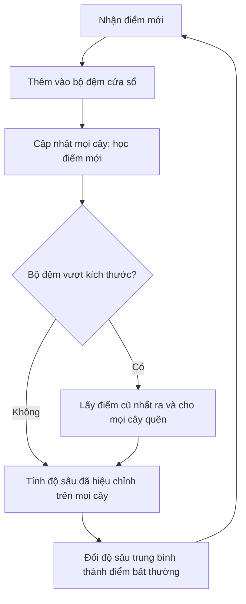

# Bắt đầu ở đây: hiểu luồng trước khi code

Đây là hướng dẫn học tập do người biên soạn viết, không phải một phần của bản dịch paper.

## Bài này giải quyết việc gì?

Ví dụ có các giao dịch lần lượt đến. Phần lớn là bình thường, một số khác lạ. Thuật toán cần gán mức độ bất thường cho từng giao dịch, xử lý nhanh, không lưu mãi mọi giao dịch và thích nghi nếu hành vi thay đổi.

Online Isolation Forest dùng nhiều cây. Mỗi cây chia không gian dữ liệu thành các ô. Vùng đông điểm được chia chi tiết hơn; vùng ít điểm được chia ít hơn. Điểm rơi vào lá nông thường có mức bất thường cao hơn. Đây là trực giác, không phải bảo đảm đúng cho mọi phân phối.

## Luồng thuật toán



Đây là thứ tự theo Thuật toán 1 của bài. Phần thực nghiệm xử lý theo lô 100 điểm, nên cần kiểm tra và ghi lại cách cập nhật/tính điểm của script tác giả khi tái tạo.

### Học một điểm là gì?

1. Đi từ gốc xuống lá theo các phép chia đã có.
2. Cập nhật số điểm và vùng bao tại các node đi qua.
3. Nếu lá đủ đông và chưa chạm giới hạn độ sâu, tách thành hai ô.
4. Bài dùng các điểm được lấy mẫu đều trong vùng bao để khởi tạo ô con; cần đọc kỹ phần này trước khi code.

### Quên một điểm là gì?

1. Khi cửa sổ đầy, bỏ điểm cũ nhất khỏi bộ đệm.
2. Giảm số điểm tại các node tương ứng.
3. Nếu một node trong không còn đủ số điểm theo ngưỡng, gộp các node con.

### Vì sao cần nhiều cây?

Mỗi cây chia ngẫu nhiên nên có thể nhìn dữ liệu khác nhau. Tổ hợp dùng độ sâu trung bình đã hiệu chỉnh để tính điểm bất thường.

## Luồng thí nghiệm

```text
Chuẩn bị dữ liệu
    → chốt cấu hình, seed, cách đưa dữ liệu vào
    → chạy thuật toán nhóm và các phương pháp so sánh
    → tính AUC, đo thời gian
    → lưu cấu hình và kết quả lên W&B
    → so với số liệu paper và bản code tác giả
    → giải thích sai lệch
    → vẽ hình, làm slide và notes
```

## Đọc paper theo ba lượt

1. **Hiểu mục tiêu:** tóm tắt, giới thiệu, kết luận. Trả lời bài giải quyết gì và điểm mạnh tác giả tuyên bố là gì.
2. **Hiểu bằng chứng:** phần dữ liệu, cấu hình, bảng kết quả và hình drift. Phân biệt tốc độ với độ chính xác.
3. **Hiểu cách làm:** Thuật toán 1 rồi các thủ tục học, quên, tính điểm; cuối cùng mới đến suy dẫn độ phức tạp.

## Cả nhóm cần trả lời được trước khi chia chạy lớn

- Đầu vào và đầu ra là gì?
- `h` khác `k` như thế nào?
- Khi nào tách, khi nào gộp?
- Cửa sổ giữ những gì và vì sao phải quên?
- Hai thí nghiệm chính đang trả lời hai câu hỏi nào?
- Số nào là của tác giả, số nào do nhóm chạy?

Đọc tiếp [bản dịch](../papers/online-isolation-forest-vi.md), [ghi chú đối chiếu](ghi-chu-doi-chieu.md) và [yêu cầu môn](yeu-cau-do-an.md).
