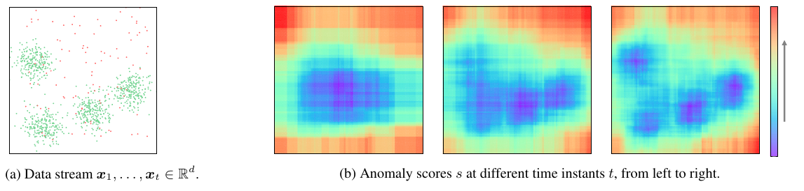
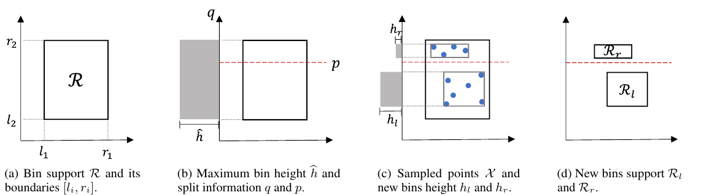
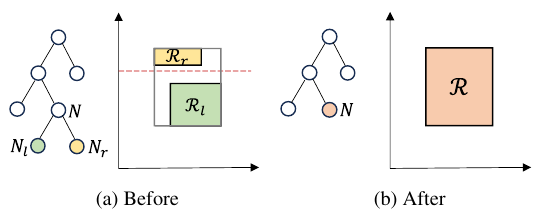
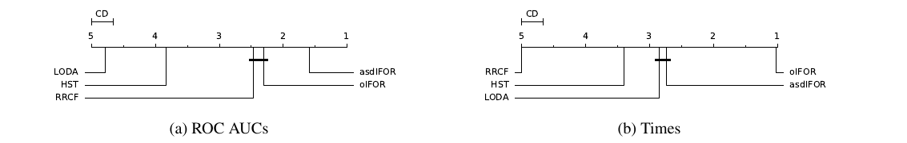
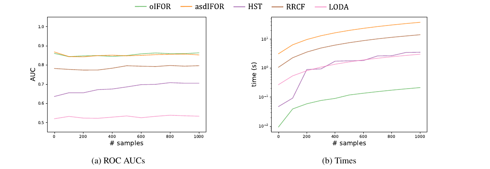
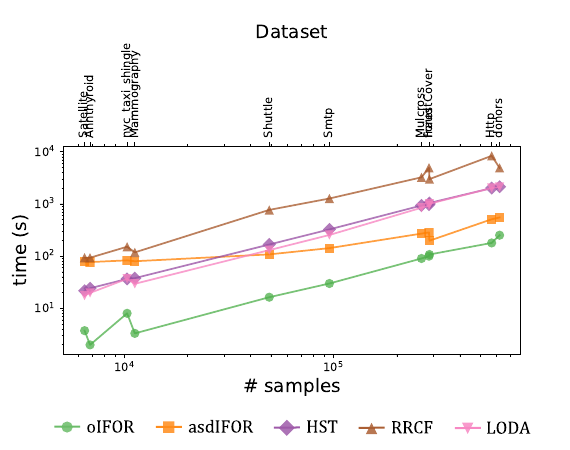
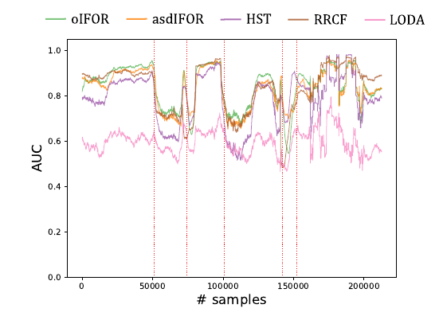

# Online Isolation Forest - Rừng cô lập trực tuyến

**Bản dịch tiếng Việt phục vụ học tập**

Tác giả: Filippo Leveni, Guilherme Weigert Cassales, Bernhard Pfahringer, Albert Bifet, Giacomo Boracchi.

Xuất bản tại Hội nghị Quốc tế về Học máy lần thứ 41 (ICML), Vienna, Áo; Proceedings of Machine Learning Research, tập 235, trang 27288-27298, năm 2024. Bản quyền năm 2024 thuộc về các tác giả.

Cơ quan: (1) Khoa Điện tử, Thông tin và Kỹ thuật Y sinh, Politecnico di Milano, Milan, Ý; (2) Viện Trí tuệ Nhân tạo, University of Waikato, Hamilton, New Zealand. Liên hệ: Filippo Leveni, filippo.leveni@polimi.it.

Nguồn dịch: [PDF gốc đi kèm](leveni24a-original.pdf), do người dùng cung cấp, gồm 11 trang. [Trang xuất bản chính thức](https://proceedings.mlr.press/v235/leveni24a.html).

> Đây là bản dịch không chính thức có AI hỗ trợ, không phải tài liệu do tác giả phê duyệt. Giữ nguyên tên thuật toán, ký hiệu, số phương trình, tên bộ dữ liệu và kết quả của bài. Đại từ “chúng tôi” trong phần dịch chỉ các tác giả. Hình được trích từ PDF để đọc đối chiếu; không được dùng nguyên hình này làm hình tự tạo của nhóm trên slide. Chú giải bổ sung của người dịch được tách riêng trong [ghi chú đối chiếu](../docs/ghi-chu-doi-chieu.md). Danh mục tài liệu tham khảo giữ thông tin thư mục gốc để tra cứu chính xác.

## Mục lục

- [Tóm tắt](#tóm-tắt)
- [1. Giới thiệu](#1-giới-thiệu)
- [2. Phát biểu bài toán](#2-phát-biểu-bài-toán)
- [3. Các công trình liên quan](#3-các-công-trình-liên-quan)
- [4. Phương pháp](#4-phương-pháp)
- [5. Thực nghiệm](#5-thực-nghiệm)
- [6. Kết luận và hướng nghiên cứu tương lai](#6-kết-luận-và-hướng-nghiên-cứu-tương-lai)
- [Lời cảm ơn và tuyên bố tác động](#lời-cảm-ơn-và-tuyên-bố-tác-động)
- [Tài liệu tham khảo](#tài-liệu-tham-khảo)

## Tóm tắt

Các nghiên cứu về phát hiện bất thường có rất nhiều phương pháp ngoại tuyến, đòi hỏi truy cập lặp lại vào dữ liệu trong bộ nhớ và đặt ra những giả định không thực tế khi áp dụng trong bối cảnh dữ liệu luồng. Những phương pháp phát hiện bất thường trực tuyến hiện có nhìn chung cũng chưa giải quyết được các ràng buộc này, mà dựa vào việc huấn luyện lại định kỳ để thích nghi với bối cảnh trực tuyến.

Chúng tôi đề xuất **Online-iForest**, một phương pháp mới được thiết kế riêng cho điều kiện dữ liệu luồng, có khả năng liên tục theo dõi quá trình sinh dữ liệu khi quá trình đó biến đổi theo thời gian. Thực nghiệm trên các bộ dữ liệu thực tế cho thấy Online-iForest đạt chất lượng tương đương những phương pháp trực tuyến khác, đồng thời gần với các kỹ thuật ngoại tuyến tiên tiến được huấn luyện lại định kỳ. Đáng chú ý, Online-iForest luôn vượt các phương pháp được so sánh về hiệu suất xử lý, khiến nó trở thành giải pháp hứa hẹn trong các ứng dụng ưu tiên phát hiện bất thường nhanh, như an ninh mạng, phát hiện gian lận và phát hiện lỗi.

## 1. Giới thiệu

Phát hiện bất thường là bài toán nhận diện dữ liệu không phù hợp với hành vi được kỳ vọng (Chandola và cộng sự, 2009). Bài toán này có nhiều ứng dụng, từ phát hiện gian lận tài chính (Ahmed và cộng sự, 2016; Dal Pozzolo và cộng sự, 2018), phát hiện xâm nhập (Bronte và cộng sự, 2016), đến theo dõi sức khỏe (Banaee và cộng sự, 2013) và giám sát chất lượng (Stojanovic và cộng sự, 2016). Thông thường, các phương pháp được huấn luyện ngoại tuyến trên một tập dữ liệu tĩnh, sau đó được dùng để phân loại những mẫu mới đến. Isolation Forest (Liu và cộng sự, 2008; 2012), viết tắt là **IFOR**, có lẽ là giải pháp phát hiện bất thường ngoại tuyến phổ biến nhất; đồng thời nó đơn giản, dễ mở rộng quy mô và cho kết quả tốt trên nhiều bộ đánh giá.

Sự phổ biến của IFOR thể hiện qua số lượng lớn các công trình phát triển từ nó. Phần lớn tìm cách cải thiện kết quả bằng việc khắc phục hạn chế của các phép chia song song với trục tọa độ (Liu và cộng sự, 2010; Hariri và cộng sự, 2021; Lesouple và cộng sự, 2021; Xu và cộng sự, 2023). Một số công trình khác mở rộng IFOR vượt ra ngoài bất thường dạng điểm để phát hiện bất thường dạng hàm (Staerman và cộng sự, 2019) và bất thường có cấu trúc (Leveni và cộng sự, 2021; 2023).

Dù có chất lượng tốt, IFOR và các biến thể vẫn là các phương pháp ngoại tuyến, không thể vận hành trực tiếp trong tình huống dữ liệu đến thành luồng vô tận và có thể biến đổi theo thời gian. Trong bối cảnh trực tuyến, mô hình ngoại tuyến nhanh chóng lỗi thời và suy giảm chất lượng. Môi trường trực tuyến đòi hỏi khả năng thích nghi liên tục, khiến cách tiếp cận ngoại tuyến không thích hợp để phát hiện bất thường hiệu quả về lâu dài.

Phát hiện bất thường trực tuyến được nghiên cứu ít hơn nhiều so với phân loại trực tuyến (Gomes và cộng sự, 2017; 2019). Phần lớn giải pháp hiện có chỉ điều chỉnh phương pháp ngoại tuyến bằng cách huấn luyện lại định kỳ. Dù tốt hơn một mô hình tĩnh, huấn luyện lại gây chi phí xử lý đáng kể. Hơn nữa, thuật toán phải xử lý luồng dữ liệu có thể vô tận, chịu giới hạn bộ nhớ nghiêm ngặt và yêu cầu chỉ duyệt dữ liệu một lần: không thể lưu toàn bộ dữ liệu để phân tích sau. Vì vậy, một cách tiếp cận nhanh và thực sự trực tuyến là thiết yếu.

Chúng tôi đề xuất **Online-iForest**, được thiết kế cho dữ liệu luồng và xử lý hiệu quả tính chất gia tăng của chúng. Online-iForest mô hình hóa phân phối dữ liệu bằng một tổ hợp các histogram đa độ phân giải, có cơ chế động để học điểm mới và quên điểm cũ. Mỗi histogram đếm số điểm trong từng ô. Khi chiều cao của một ô đạt ngưỡng tối đa, ô đó được tách để tăng độ phân giải tại những vùng tập trung nhiều điểm nhất. Ngược lại, các ô ở vùng thưa điểm cuối cùng sẽ được gộp, làm giảm độ phân giải tại đó.



**Hình 1.** Online-iForest tự điều chỉnh theo phân phối dữ liệu của luồng và cải thiện ước lượng điểm bất thường theo thời gian. (a) Luồng dữ liệu $x_1,\ldots,x_t\in\mathbb R^d$. (b) Điểm bất thường $s$ tại các thời điểm $t$ khác nhau, từ trái sang phải.

Hình 1 minh họa khả năng học trực tuyến bằng một ví dụ đơn giản. Dữ liệu bình thường, màu xanh lá, phân bố dày hơn dữ liệu bất thường, màu đỏ. Online-iForest xử lý từng điểm trong Hình 1a theo thứ tự luồng và gán cho mỗi điểm một điểm số bất thường. Khi luồng tiếp tục, phương pháp thu nhận thêm thông tin về phân phối và cải thiện ước lượng điểm số tương ứng (Hình 1b).

Thực nghiệm cho thấy Online-iForest hoạt động đặc biệt nhanh, đáp ứng yêu cầu tốc độ cao của dữ liệu luồng, trong khi chất lượng phát hiện tương đương các kỹ thuật trực tuyến tiên tiến. Những đặc điểm đó khiến phương pháp trở thành lựa chọn hứa hẹn cho ứng dụng dữ liệu luồng. Mã nguồn được công bố tại https://github.com/ineveLoppiliF/Online-Isolation-Forest.

## 2. Phát biểu bài toán

Chúng tôi xét bài toán phát hiện bất thường trực tuyến trên một luồng dữ liệu đa biến gần như vô hạn $x_1,x_2,\ldots,x_t\in\mathbb R^d$, với $t\ge1$. Giả sử mỗi $x_i$ là một giá trị quan sát của biến ngẫu nhiên độc lập và cùng phân phối (i.i.d.), có phân phối chưa biết thuộc một trong hai loại: $X_i\sim\Phi_0$ hoặc $X_i\sim\Phi_1$. Trong đó, $\Phi_0$ là phân phối dữ liệu bình thường và $\Phi_1$ là phân phối dữ liệu bất thường. Với mỗi điểm $x_t$, mục tiêu là xác định $X_t\sim\Phi_0$ hay $X_t\sim\Phi_1$ tại từng thời điểm $t$.

Chúng tôi giả sử điểm bất thường là **“ít” và “khác biệt”** (Liu và cộng sự, 2008), cụ thể:

1. **Ít:** xác suất điểm $x_i$ được sinh từ phân phối bất thường nhỏ hơn nhiều so với xác suất được sinh từ phân phối bình thường:

   $$P(X_i\sim\Phi_1)\ll P(X_i\sim\Phi_0).$$

2. **Khác biệt:** xác suất điểm $x_i$ nằm gần một điểm bất thường $x_j$ hơn một điểm bình thường $x_k$ là thấp.

Vì vậy, chúng tôi tập trung vào những tình huống mà dữ liệu bất thường không hình thành các cụm vừa dày đặc vừa đông điểm.

Ngoài ra, giả sử tại mỗi thời điểm $t$ chỉ có thể giữ trong bộ nhớ một tập con hữu hạn và nhỏ $x_{t-\omega},\ldots,x_t$, có kích thước $\omega$, với $\omega$ đủ nhỏ. Đồng thời, khoảng thời gian từ lúc thu nhận mẫu $x_t$ đến lúc phân loại mẫu đó phải ngắn nhất có thể.

## 3. Các công trình liên quan

Trong số nhiều nghiên cứu về phát hiện bất thường (Chandola và cộng sự, 2009), chúng tôi tập trung vào các phương pháp dựa trên cây vì chúng đạt chất lượng hàng đầu với yêu cầu tính toán và bộ nhớ thấp. IFOR (Liu và cộng sự, 2008; 2012) đưa ra khái niệm **“cô lập”** làm tiêu chí nhận diện bất thường. Các công trình sau chỉ ra mối liên hệ chặt chẽ của khái niệm này với khoảng cách và mật độ (Zhang và cộng sự, 2017; Leveni và cộng sự, 2023).

Thành phần cốt lõi của IFOR là một tổ hợp cây ngẫu nhiên được xây dựng bằng quá trình phân nhánh lặp lại. Mỗi cây chọn ngẫu nhiên một chiều dữ liệu và một giá trị chia nằm trong hộp bao dữ liệu theo chiều đó. Điểm bất thường được nhận diện bằng điểm số tính từ độ dài đường đi trung bình từ gốc tới lá, dựa trên giả định rằng chúng dễ bị cô lập hơn.

**Isolation Forest ASD (asdIFOR).** Cách mở rộng IFOR đơn giản nhất cho dữ liệu luồng là Isolation Forest ASD (Ding và Fei, 2013). Phương pháp định kỳ huấn luyện từ đầu một tổ hợp IFOR mới trên dữ liệu gần nhất rồi bỏ tổ hợp cũ. Huấn luyện lại định kỳ làm chậm việc thích nghi với dữ liệu mới, và tùy tần suất thực hiện, làm chậm quá trình xử lý. Trái lại, Online-iForest cập nhật cấu trúc bên trong tại mỗi mẫu mới, cho phép phát hiện bất thường nhanh và thực sự trực tuyến.

**Robust Random Cut Forest (RRCF).** RRCF (Guha và cộng sự, 2016) là nỗ lực đầu tiên nhằm điều chỉnh IFOR cho dữ liệu luồng. Nó quản lý cấu trúc cây một cách động và đưa ra điểm bất thường mới dựa trên sự chênh lệch về độ phức tạp của cây khi loại một điểm khỏi luồng. Điểm số dựa trên giả định rằng điểm bất thường tác động đến cấu trúc cây rõ hơn điểm bình thường. Tuy nhiên, các phép sửa cây của RRCF thường tốn tài nguyên hơn việc tách/gộp ô nhanh của Online-iForest.

**LODA.** LODA (Pevný, 2016) sử dụng bổ đề Johnson-Lindenstrauss (Johnson và Lindenstrauss, 1984) để chiếu dữ liệu xuống các không gian một chiều, sau đó mô hình hóa phân phối bằng histogram một chiều. Các histogram có độ phân giải cố định, nên không hiệu quả trong mô tả dữ liệu đa mode và cách sắp xếp phức tạp. Trái lại, histogram của Online-iForest có thể tăng độ phân giải và thích nghi với nhiều cấu hình dữ liệu.

**Half Space Trees (HST).** Khác LODA, HST (Tan và cộng sự, 2011) sử dụng một tổ hợp histogram đa độ phân giải trong không gian $d$ chiều. HST xây dựng các cây nhị phân đầy đủ bằng cách chọn ngẫu nhiên một chiều và chia đôi không gian tại trung điểm. Giả sử điểm bất thường nằm trong vùng thưa điểm, tác giả HST đề xuất điểm số dựa trên khối lượng tại node. Tương tự asdIFOR, HST chịu hạn chế của việc huấn luyện lại định kỳ. Hơn nữa, các ô được tạo khi chưa quan sát dữ liệu, dẫn đến độ phân giải cao ở những vùng trống và sử dụng bộ nhớ kém hiệu quả. Ngược lại, histogram phụ thuộc dữ liệu của Online-iForest mô tả chi tiết hơn ở những vùng đông điểm nhất.

## 4. Phương pháp

Online-iForest, ký hiệu $F$, là một tổ hợp các **Online-iTree** $\{T_1,\ldots,T_\tau\}$ được thiết kế để học liên tục, hiệu quả theo luồng và thích nghi với phân phối dữ liệu thay đổi. Mỗi Online-iTree là một histogram $d$ chiều; cả cấu trúc ô và chiều cao ô đều thay đổi khi nó thu thập thêm thông tin về các phân phối chưa biết $\Phi_0$ và $\Phi_1$.

Chúng tôi dùng bộ đệm trượt $W=[x_{t-\omega},\ldots,x_t]$ lưu $\omega$ điểm gần nhất. Tại mỗi thời điểm $t$, điểm mới nhất $x_t$ và điểm cũ nhất $x_{t-\omega}$ lần lượt được dùng để mở rộng và thu gọn cây.

Thuật toán 1 khởi tạo bộ đệm $W$ rỗng và mỗi cây chỉ có node gốc. Tại thời điểm $t$, lấy điểm mới $x_t$ từ luồng (dòng 4), lưu vào bộ đệm và cập nhật mọi cây (dòng 5-7). Một cây học điểm mới bằng cách cập nhật các ô trên đường từ gốc tới lá tương ứng, có thể mở rộng cấu trúc như trong Thuật toán 2. Tiếp theo, lấy điểm cũ nhất $x_{t-\omega}$ ra khỏi $W$ và yêu cầu mọi cây quên điểm đó (dòng 8-11), tức cập nhật các ô dọc đường đi đến lá. Khác với học, quên có thể thu gọn cấu trúc cây, như trong Thuật toán 3. Mục 4.1 trình bày hai thủ tục này cụ thể hơn.

### Thuật toán 1. Online-iForest

Đầu vào: $\omega$ - kích thước cửa sổ; $\tau$ - số cây; $\eta$ - tham số số mẫu tối đa tại lá.

```text
01  Khởi tạo W là danh sách rỗng.
02  Khởi tạo F gồm τ cây rỗng {T₁, ..., Tτ}.
03  Lặp vô hạn:
04      xₜ ← lấy điểm từ luồng
        // Cập nhật rừng
05      Thêm xₜ vào W
06      Với i = 1, ..., τ:
07          learn_point(xₜ, Tᵢ.rootN, η, c(ω, η))
08      Nếu độ dài W lớn hơn ω:
09          xₜ₋ω ← lấy và xóa điểm cũ nhất trong W
10          Với i = 1, ..., τ:
11              forget_point(xₜ₋ω, Tᵢ.rootN, η)
        // Tính điểm bất thường
12      D ← tập rỗng
13      Với i = 1, ..., τ:
14          Thêm point_depth(xₜ, Tᵢ.rootN) vào D
15      sₜ ← 2^(-E(D) / c(ω, η))
```

Chúng tôi tính điểm bất thường $s_t\in[0,1]$ của $x_t$ (dòng 12-15) theo nguyên lý IFOR (Liu và cộng sự, 2008). Vì điểm bất thường dễ bị cô lập hơn, chúng thường bị tách ra sớm trong quá trình chia đệ quy của cây ngẫu nhiên. Do đó, chúng tôi tính độ sâu của các lá mà $x_t$ rơi vào trong mọi cây $T\in F$, rồi chuyển các độ sâu thành điểm số bằng hàm chuẩn hóa:

$$s_t\leftarrow 2^{-\frac{E(D)}{c(\omega,\eta)}}. \tag{1}$$

Ở đây $E(D)$ là độ sâu trung bình trên tất cả $\tau$ cây, còn $c(\omega,\eta)=\log_2(\omega/\eta)$ là hệ số hiệu chỉnh theo kích thước cửa sổ $\omega$ và tham số $\eta$ điều khiển số điểm cần để tách ô. Hệ số hiệu chỉnh biểu diễn độ sâu trung bình của một Online-iTree, được suy dẫn ở Mục 4.2. Cách tính độ sâu của lá chứa $x_t$ được nêu trong Thuật toán 4.

### 4.1. Online-iTree

Thành phần cơ bản của phương pháp là cấu trúc Online-iTree. Mỗi cây là một histogram $d$ chiều được xây dựng bằng cách chia đệ quy không gian đầu vào $\mathbb R^d$ thành các ô; mỗi ô lưu số điểm rơi vào vùng không gian tương ứng. Chúng tôi định nghĩa Online-iTree là một tập node động $T=\{N_j\}_{j=1,\ldots,m}$, liên tục cập nhật khi học điểm mới và quên điểm cũ.

Node thứ $j$ được mô tả bởi $N_j=(h_j,R_j)$. Trong đó, $h_j$ là số điểm đi qua node trên đường đến lá, tức **chiều cao ô**; còn

$$R_j=\mathop{\times}_{i=1}^{d}[l_i,r_i]$$

là siêu hộp chữ nhật nhỏ nhất trong không gian $d$ chiều bao các điểm đó, tức **miền bao của ô**. Ký hiệu $\times$ là tích Descartes. Hai đại lượng $h_j$ và $R_j$ đủ để thực hiện việc điều chỉnh IFOR trực tuyến một cách hiệu quả.

Khi có mẫu mới $x_t$, chúng tôi chạy thủ tục học độc lập trên từng cây. Điểm đi tới lá tương ứng, và chiều cao $h$ cùng miền bao $R$ của mọi ô dọc đường đi được cập nhật. Khi một lá đạt chiều cao tối đa $\hat h$, chúng tôi tách ô thành hai phần theo Hình 2. Quá trình lặp lại đến khi cửa sổ $W$ đầy. Từ đó, bên cạnh việc học điểm mới $x_t$, thuật toán thực hiện quên điểm cũ nhất $x_{t-\omega}$. Quên có thể gộp các ô lân cận thành một ô, như Hình 3. Cơ chế cập nhật hai chiều này cho phép cây (i) học tăng dần khi luồng bắt đầu và (ii) theo dõi sự biến đổi của luồng.

Những ô thuộc vùng đông điểm được tách thường xuyên; những ô thuộc vùng thưa điểm được tách ít hơn. Vì mỗi lần tách làm tăng độ sâu của lá, chúng ta có thể phân biệt điểm bất thường và bình thường qua độ sâu $k$ của lá chứa chúng. Trong Hình 1b, một tổ hợp cây gán điểm số khác nhau cho các vùng đông và thưa điểm.



**Hình 2.** Quy trình tách một lá $N=(h,R)$ trong cây $T$. (a) Miền bao $R$ và các biên $[l_i,r_i]$. (b) Khi đạt chiều cao tối đa $\hat h$, chọn ngẫu nhiên chiều chia $q$ và giá trị chia $p$. (c) Lấy ngẫu nhiên tập $X$ gồm $\hat h$ điểm từ $R$, dùng để khởi tạo chiều cao $h_l,h_r$ của các ô mới. (d) Miền bao mới $R_l,R_r$ của các node con $N_l=(h_l,R_l)$ và $N_r=(h_r,R_r)$.

#### Thủ tục học

Mỗi khi đưa điểm $x_t$ vào cây bằng thủ tục học, chúng tôi cập nhật chiều cao $h$ và miền bao $R$ của mọi node trên đường từ gốc tới lá (dòng 2 của Thuật toán 2). Khi chiều cao của một lá đạt giá trị tối đa $\hat h$, chúng tôi tăng độ phân giải tại vùng đó bằng cách chia ô làm hai, sinh hai node con $N_l,N_r$.

Chiều cao tối đa của ô được định nghĩa là

$$\hat h=\eta\,2^k,$$

với $\eta$ do người dùng chọn, và $k$ là độ sâu của node $N\in T$. Vì ngưỡng tăng theo hàm mũ của độ sâu, các node sâu hơn cần nhiều điểm hơn để được tách. Lựa chọn này tạo các cây gọn, đem lại lợi ích đáng kể về hiệu suất xử lý. Chỉ thực hiện tách khi độ sâu lá $k$ nhỏ hơn giới hạn

$$\delta=\log_2(\omega/\eta),$$

phụ thuộc kích thước cửa sổ $\omega$ và tham số $\eta$. Cây giới hạn độ sâu đã được thảo luận trong IFOR như một cách xử lý hiệu ứng nhận nhầm điểm bình thường thành bất thường và che khuất điểm bất thường (swamping và masking; Murphy, 1951).

Thủ tục tách khi đạt $\hat h$ diễn ra như sau. Trước tiên, chọn ngẫu nhiên chiều $q\in\{1,\ldots,d\}$ và giá trị chia $p\in[l_q,r_q]$ từ các biến ngẫu nhiên $Q\sim U_{\{1,\ldots,d\}}$ và $P\sim U_{[l_q,r_q]}$, với $U$ chỉ phân phối đều (dòng 5-6 của Thuật toán 2).

Tiếp theo, lấy tập $X$ gồm $\hat h$ điểm từ miền $R=\mathop{\times}_{i=1}^{d}[l_i,r_i]$, sao cho mỗi điểm $x\in X$ có phân phối đều $X\sim U_R$ (dòng 7). Cách lấy mẫu này dựa trên việc xấp xỉ phân phối dữ liệu bằng phân phối đều từng phần, biểu diễn bởi hợp các ô tại lá.

Cuối cùng, chia các phần tử của $X$ thành

$$X_l=\{x\in X\mid x_q<p\},\qquad X_r=\{x\in X\mid x_q\ge p\},$$

rồi dùng chúng để khởi tạo chiều cao $h_l,h_r$ và miền bao $R_l,R_r$ của hai node con mới (dòng 8-10). Hình 2 minh họa quy trình với $d=2$.

### Thuật toán 2. Online-iTree - học điểm

Đầu vào: $x$ - dữ liệu đầu vào; $N$ - một node; $\eta$ - tham số số mẫu tại lá; $\delta$ - giới hạn độ sâu.

```text
01  Hàm learn_point(x, N, η, δ):
02      Cập nhật chiều cao ô h và miền bao R
03      Nếu N là lá:
04          Nếu h ≥ η·2^k và k < δ:
05              q ← lấy đều ngẫu nhiên từ {1, ..., d}
06              p ← lấy đều ngẫu nhiên từ [lq, rq]
07              X ← lấy mẫu từ phân phối đều trên R
08              Chia X thành Xl và Xr
09              Tính hl, hr và Rl, Rr
10              Khởi tạo các node con Nl, Nr
11      Ngược lại:
12          Nếu xq < p:
13              learn_point(x, Nl, η, δ)
14          Ngược lại:
15              learn_point(x, Nr, η, δ)
```

#### Thủ tục quên

Trái với học, vốn tạo node và tăng độ phân giải histogram, quên gộp các node cùng ô tương ứng, giảm số ô và độ phân giải tại vùng đó. Cụ thể, mỗi khi đưa điểm $x_{t-\omega}$ vào thủ tục quên, chúng tôi giảm chiều cao $h$ của mọi node $N$ mà điểm đi qua trên đường từ gốc tới lá (dòng 2 của Thuật toán 3).

Khi chiều cao của một node trong, tức node từng được tách, giảm xuống dưới ngưỡng $\hat h$, chúng tôi xóa phép chia tại $N$ bằng cách gộp hai node con $N_l,N_r$. Thủ tục ở Hình 3 trước tiên cập nhật $R$ thành siêu hộp chữ nhật nhỏ nhất bao được hai miền $R_l,R_r$ (dòng 5). Sau đó bỏ thông tin phép chia $q,p$ và hai node con (dòng 6).



**Hình 3.** (a) Trước và (b) sau thủ tục quên: miền $R$ của node $N$ là siêu hộp chữ nhật nhỏ nhất bao được các miền $R_l,R_r$ của hai node con $N_l,N_r$.

### Thuật toán 3. Online-iTree - quên điểm

Đầu vào: $x$ - dữ liệu đầu vào; $N$ - một node; $\eta$ - tham số số mẫu tại lá.

```text
01  Hàm forget_point(x, N, η):
02      Giảm chiều cao ô h
03      Nếu N KHÔNG phải lá:
04          Nếu h < η·2^k:
05              Cập nhật miền bao R từ Rl, Rr
06              Bỏ phép chia q, p và các node con Nl, Nr
07          Ngược lại:
08              Nếu xq < p:
09                  forget_point(x, Nl, η)
10              Ngược lại:
11                  forget_point(x, Nr, η)
```

### Thuật toán 4. Online-iTree - độ sâu của điểm

Đầu vào: $x$ - dữ liệu; $N$ - node; $\eta$ - tham số số mẫu tại lá. Đầu ra: độ sâu của điểm $x$.

```text
01  Hàm point_depth(x, N):
02      Nếu N là lá:
03          Trả về k + c(h, η)
04      Ngược lại:
05          Nếu xq < p:
06              Trả về point_depth(x, Nl)
07          Ngược lại:
08              Trả về point_depth(x, Nr)
```

### 4.2. Phân tích độ phức tạp

Độ phức tạp tính toán rất quan trọng trong môi trường trực tuyến: cần xử lý luồng nhanh với bộ nhớ thấp. Độ phức tạp thời gian và bộ nhớ của Online-iForest gắn chặt với độ sâu của các cây thành phần. Vì vậy, trước tiên chúng tôi suy dẫn độ sâu trong trường hợp trung bình và xấu nhất, sau đó biểu diễn độ phức tạp theo các độ sâu này (Bảng 1).

**Bảng 1. Độ phức tạp trung bình và xấu nhất của Online-iForest.**

| Đại lượng | Trường hợp trung bình | Trường hợp xấu nhất |
|---|---|---|
| Thời gian | $O(n\tau\log_2(\omega/\eta))$ | $O(n\tau\log_2(\omega/\eta))$ |
| Bộ nhớ | $O(\tau\sqrt{\omega/\eta}+\omega)$ | $O(\tau\omega/\eta+\omega)$ |

#### Trường hợp trung bình

Để xác định độ sâu trung bình $\bar k$, lưu ý rằng cây nhị phân cân bằng hoàn hảo xây dựng từ $\omega$ điểm có đúng $\omega/2^k$ điểm tại mỗi node ở độ sâu $k$ (Knuth, 2023). Vì node ở độ sâu $k$ cần $\eta 2^k$ điểm để tách, độ sâu $k$ tồn tại khi và chỉ khi

$$\frac{\omega}{2^{k-1}}\ge\eta 2^{k-1}. \tag{2}$$

Nghĩa là phải có đủ điểm ở độ sâu $k-1$ để thực hiện phép tách. Giải bất đẳng thức theo $k$:

$$k\le\frac12\log_2\frac{\omega}{\eta}+1. \tag{3}$$

Từ đó, độ sâu trung bình của một Online-iTree là

$$\bar k=\left\lfloor\frac12\log_2\frac{\omega}{\eta}+1\right\rfloor. \tag{4}$$

Vì vậy, độ phức tạp thời gian trung bình của Online-iForest, tức chi phí đi qua mỗi cây từ gốc tới lá, là $O(n\tau\log_2(\omega/\eta))$, với $\tau$ là số cây và $n$ là số mẫu trong luồng.

Độ phức tạp bộ nhớ trung bình được biểu diễn bằng số node của cây, vốn phụ thuộc độ sâu trung bình $\bar k$, cộng kích thước bộ đệm $\omega$. Một cây nhị phân cân bằng hoàn hảo sâu $k$ có $2^{k+1}-1$ node (Knuth, 2023). Do đó:

$$O\left(\tau 2^{\frac12\log_2(\omega/\eta)}+\omega\right)
=O\left(\tau\sqrt{\frac{\omega}{\eta}}+\omega\right).$$

Đại lượng này không phụ thuộc số mẫu $n$ trong luồng.

#### Trường hợp xấu nhất

Một cây nhị phân suy biến thành danh sách liên kết, xây dựng từ $\omega$ điểm, có $\omega-k$ điểm ở độ sâu $k$. Tương tự trường hợp trung bình, độ sâu $k$ tồn tại khi và chỉ khi

$$\omega-(k-1)\ge\eta 2^{k-1}. \tag{5}$$

Giải theo $k$ rồi đặt cận trên:

$$k\le\log_2\frac{\omega+1-k}{\eta}+1
\le\log_2\frac{\omega+1}{\eta}+1. \tag{6}$$

Suy ra độ sâu trường hợp xấu nhất thỏa

$$\widetilde k\le\left\lfloor\log_2\frac{\omega+1}{\eta}+1\right\rfloor. \tag{7}$$

Vì vậy, độ phức tạp thời gian và bộ nhớ trường hợp xấu nhất lần lượt là

$$O\left(n\tau\log_2\frac{\omega}{\eta}\right),$$

$$O\left(\tau 2^{\log_2((\omega+1)/\eta)}+\omega\right)
=O\left(\tau\frac{\omega}{\eta}+\omega\right).$$

### 4.3. Tốc độ thích nghi và độ chính xác mô hình hóa

Độ dài cửa sổ $\omega$ có vai trò quan trọng trong điều khiển sự đánh đổi giữa tốc độ thích nghi và độ chính xác mô hình hóa. Cửa sổ nhỏ giúp Online-iForest thích nghi nhanh với thay đổi, nhưng mô hình hóa phân phối bên dưới một cách thô hơn.

Hình 1b cho thấy điểm bất thường khi thuật toán xử lý số điểm tăng dần. Từ trái qua phải là phân phối được học sau 100, 300 và 1.000 điểm, tương đương những gì thuật toán học với các cửa sổ có độ dài tương ứng. Sau 100 điểm, điểm số còn thô; sau 1.000 điểm, nó mô tả phân phối chi tiết hơn.

## 5. Thực nghiệm

Trước tiên, chúng tôi so sánh Online-iForest với các phương pháp tiên tiến trên một bộ đánh giá phát hiện bất thường lớn, trong đó các phân phối bình thường $\Phi_0$ và bất thường $\Phi_1$ là dừng. Sau đó, chúng tôi dùng một bộ dữ liệu có trôi khái niệm để đánh giá khả năng thích nghi với thay đổi phân phối.

### 5.1. Các bộ dữ liệu

**Dữ liệu dừng.** Chúng tôi dùng tám bộ dữ liệu lớn nhất trong Liu và cộng sự (2008; 2012): Http, Smtp (Yamanishi và cộng sự, 2004), Annthyroid, Forest Cover Type, Satellite, Shuttle (Asunction và Newman, 2007), Mammography và Mulcross (Rocke và Woodruff, 1996); thêm hai bộ dữ liệu từ cuộc thi Kaggle là Donors và Fraud (Pang và cộng sự, 2019), và phiên bản ghép cửa sổ (shingled) của NYC Taxicab dùng trong Guha và cộng sự (2016).

Các bộ dữ liệu này chứa dữ liệu thực, với các phân phối $\Phi_0,\Phi_1$ chưa biết, và có nhãn bất thường để đánh giá kết quả. Số mẫu $n$, số chiều $d$ và tỷ lệ bất thường được trình bày trong Bảng 2.

**Bảng 2. Đặc điểm của các bộ dữ liệu dừng.**

| Bộ dữ liệu | Số mẫu $n$ | Số chiều $d$ | Tỷ lệ bất thường (%) |
|---|---:|---:|---:|
| Donors | 619326 | 10 | 5.90 |
| Http | 567497 | 3 | 0.40 |
| ForestCover | 286048 | 10 | 0.90 |
| Fraud | 284807 | 29 | 0.17 |
| Mulcross | 262144 | 4 | 10.00 |
| Smtp | 95156 | 3 | 0.03 |
| Shuttle | 49097 | 9 | 7.00 |
| Mammography | 11183 | 6 | 2.00 |
| nyc_taxi_shingle | 10273 | 48 | 5.20 |
| Annthyroid | 6832 | 6 | 7.00 |
| Satellite | 6435 | 36 | 32.00 |

**Dữ liệu không dừng.** Chúng tôi dùng INSECTS (Souza và cộng sự, 2020), trước đó được dùng cho phát hiện thay đổi (Frittoli và cộng sự, 2023; Stucchi và cộng sự, 2023a;b). INSECTS gồm các vector đặc trưng $d=33$ mô tả tần số đập cánh của sáu loài côn trùng bay đã được gán nhãn. Bộ dữ liệu có năm thay đổi thực do nhiệt độ thay đổi và tác động đến hành vi bay.

Cho bài toán này, chúng tôi chọn hai lớp đông nhất làm dữ liệu bình thường: `ae-aegypti-female` và `cx-quinq-male`; lớp ít nhất, `ae-albopictus-male`, làm bất thường. Kết quả gồm $n=212514$ điểm, với tỷ lệ bất thường 5.50%.

### 5.2. Các phương pháp so sánh và phương pháp thực nghiệm

Chúng tôi so sánh Online-iForest, viết tắt **oIFOR**, với các phương pháp phát hiện bất thường trực tuyến được mô tả ở Mục 3: iForestASD (**asdIFOR**), Half Space Trees (**HST**), Robust Random Cut Forest (**RRCF**) và **LODA**, sử dụng các bản cài đặt trong PySAD (Yilmaz và Kozat, 2020).

Để so sánh, chúng tôi đặt số cây $\tau=32$ cho mọi thuật toán; số phép chiếu/cắt ngẫu nhiên trong LODA được xem tương đương số cây. Kích thước cửa sổ là $\omega=2048$ cho oIFOR và asdIFOR; HST dùng mặc định $\omega=250$. Kích thước lấy mẫu con để dựng cây trong asdIFOR là mặc định $\psi=256$. Số ô trên mỗi phép chiếu ngẫu nhiên của LODA là $b=100$.

Độ sâu tối đa $\delta$ phụ thuộc kích thước lấy mẫu con $\psi$ ở asdIFOR, phụ thuộc kích thước cửa sổ $\omega$ và tham số tách ô $\eta$ ở oIFOR; HST dùng mặc định $\delta=15$. Các cấu hình được tổng hợp trong Bảng 3.

**Bảng 3. Tham số chạy các thuật toán.** Dấu “-” biểu thị ô không áp dụng/không được điền trong bảng gốc.

| Thuật toán | $\tau$ | $\omega$ | $\eta$ | $\psi$ | $\delta$ | $b$ |
|---|---:|---:|---:|---:|---|---:|
| oIFOR | 32 | 2048 | 32 | - | $\log_2(\omega/\eta)$ | - |
| asdIFOR | 32 | 2048 | - | 256 | $\log_2\psi$ | - |
| HST | 32 | 250 | - | - | 15 | - |
| RRCF | 32 | - | - | 256 | - | - |
| LODA | 32 | - | - | - | - | 100 |

Mỗi thuật toán được chạy **30 lần** trên cả dữ liệu dừng và không dừng. Trước mỗi lần chạy, chúng tôi xáo trộn ngẫu nhiên từng bộ dữ liệu dừng, sau đó dùng cùng phiên bản đã xáo trộn cho tất cả thuật toán. Do quy mô luồng, xử lý từng điểm riêng biệt tốn thời gian quá lớn. Để giải quyết, chúng tôi chia mỗi bộ dữ liệu thành các **lô 100 điểm**, lần lượt đưa từng lô vào thuật toán theo cách trực tuyến.

Chúng tôi dùng **ROC AUC** để đánh giá chất lượng phát hiện và **thời gian thực thi, tính bằng giây**, để đánh giá hiệu suất xử lý. Ngoài ra, chúng tôi dùng biểu đồ chênh lệch tới hạn (critical difference diagram) cho cả hai thước đo nhằm tổng hợp kết quả qua nhiều lần chạy trên các bộ dữ liệu có đặc điểm khác nhau.

### 5.3. Kết quả

#### Phát hiện bất thường trên luồng dữ liệu dừng

Bảng 4 trình bày trung vị ROC AUC sau khi xử lý mỗi bộ dữ liệu và trung vị tổng thời gian thực thi để xử lý toàn bộ luồng. Hai dòng cuối lần lượt là trung vị và thứ hạng trung bình trên tổng cộng 330 lần thực thi. Bản gốc in đậm kết quả tốt nhất theo từng hàng; để dễ đọc, bản dịch tách bảng gốc thành hai bảng con, giữ nguyên số liệu.

**Bảng 4a. ROC AUC, càng cao càng tốt. Đây là số liệu của tác giả, không phải kết quả nhóm.**

| Bộ dữ liệu | oIFOR | asdIFOR | HST | RRCF | LODA |
|---|---:|---:|---:|---:|---:|
| Donors | 0.795 | 0.769 | 0.715 | 0.637 | 0.554 |
| Http | 0.998 | 0.999 | 0.992 | 0.996 | 0.632 |
| ForestCover | 0.887 | 0.861 | 0.722 | 0.917 | 0.500 |
| Fraud | 0.936 | 0.946 | 0.910 | 0.951 | 0.722 |
| Mulcross | 0.995 | 0.952 | 0.011 | 0.800 | 0.506 |
| Smtp | 0.861 | 0.905 | 0.851 | 0.894 | 0.731 |
| Shuttle | 0.992 | 0.996 | 0.981 | 0.957 | 0.528 |
| Mammography | 0.854 | 0.855 | 0.831 | 0.824 | 0.622 |
| nyc_taxi_shingle | 0.572 | 0.709 | 0.342 | 0.725 | 0.499 |
| Annthyroid | 0.685 | 0.810 | 0.636 | 0.740 | 0.589 |
| Satellite | 0.651 | 0.709 | 0.531 | 0.662 | 0.501 |
| Trung vị | 0.866 | 0.863 | 0.739 | 0.832 | 0.541 |
| Thứ hạng trung bình | 2.167 | 1.583 | 3.917 | 2.500 | 4.833 |

**Bảng 4b. Tổng thời gian thực thi (giây), càng thấp càng tốt. Đây là số liệu của tác giả.**

| Bộ dữ liệu | oIFOR | asdIFOR | HST | RRCF | LODA |
|---|---:|---:|---:|---:|---:|
| Donors | 252.36 | 551.85 | 2145.85 | 4924.46 | 2111.09 |
| Http | 179.36 | 509.40 | 2016.00 | 8367.16 | 2017.85 |
| ForestCover | 107.65 | 197.82 | 1045.39 | 2997.86 | 1009.92 |
| Fraud | 100.09 | 285.69 | 973.91 | 4936.03 | 931.93 |
| Mulcross | 90.33 | 270.79 | 936.01 | 3244.96 | 848.12 |
| Smtp | 29.95 | 142.65 | 325.77 | 1273.98 | 254.69 |
| Shuttle | 16.35 | 108.28 | 167.48 | 770.61 | 130.61 |
| Mammography | 3.32 | 80.01 | 37.92 | 118.22 | 29.55 |
| nyc_taxi_shingle | 8.03 | 83.15 | 36.70 | 151.67 | 36.82 |
| Annthyroid | 2.00 | 77.06 | 24.26 | 93.40 | 19.79 |
| Satellite | 3.74 | 78.90 | 21.78 | 93.77 | 17.55 |
| Trung vị | 29.95 | 142.57 | 323.29 | 1274.45 | 254.64 |
| Thứ hạng trung bình | 1.000 | 2.667 | 3.500 | 5.000 | 2.833 |

oIFOR có chi phí thời gian thấp nhất, cách biệt rõ so với mọi đối thủ trong thí nghiệm. So với phương pháp nhanh thứ hai, asdIFOR, thời gian của oIFOR nhỏ hơn một nửa trên bốn trong năm bộ dữ liệu lớn nhất, và giảm hơn một bậc độ lớn trên bốn trong sáu bộ nhỏ nhất.

Kết quả này được xác nhận bởi biểu đồ chênh lệch tới hạn ở Hình 4b: oIFOR tốt hơn có ý nghĩa thống kê so với các phương pháp còn lại, còn LODA và asdIFOR tương đương thống kê. Phân tích thống kê được thực hiện trên năm nhóm, một nhóm cho mỗi thuật toán, với 330 giá trị tổng thời gian được ghép cặp. Biểu đồ dựa trên kiểm định hậu nghiệm Nemenyi; khác biệt có ý nghĩa khi chênh lệch thứ hạng trung bình lớn hơn khoảng cách tới hạn $CD=0.336$. Thứ hạng và biểu đồ được tạo bằng thư viện Autorank (Herbold, 2020).



**Hình 4.** Biểu đồ chênh lệch tới hạn cho (a) ROC AUC và (b) tổng thời gian thực thi.

Trong Hình 6, chúng tôi sắp xếp trung vị tổng thời gian ở Bảng 4 theo kích thước bộ dữ liệu, qua đó thấy xu hướng tuyến tính của tất cả thuật toán.

Bảng 4 cho thấy oIFOR, asdIFOR và RRCF đạt chất lượng phát hiện tốt nhất trên các bộ dữ liệu khác nhau. Dù oIFOR có trung vị ROC AUC tổng thể nhỉnh hơn, kiểm định Nemenyi cho thấy asdIFOR là phương pháp hiệu quả nhất về phát hiện, còn oIFOR và RRCF tương đương thống kê (Hình 4a).

Kết quả rất thấp của HST trên Mulcross là do các cụm bất thường lớn, có mật độ bằng hoặc cao hơn cụm bình thường. Tình huống này kết hợp với độ sâu tối đa mặc định $\delta$ lớn khiến HST đặc biệt khó xử lý, vì nó dựa trên giả định ngược lại.

#### Học ở giai đoạn đầu của luồng

Bên cạnh đánh giá khả năng phát hiện cuối cùng như thông lệ, chúng tôi nhấn mạnh tốc độ học ban đầu. Chúng tôi tập trung vào giai đoạn khởi đầu quan trọng, phân tích kết quả trong **1.000 mẫu đầu tiên**.

Các đường liền ở Hình 5a là trung vị ROC AUC của từng thuật toán qua 30 lần chạy trên 11 bộ dữ liệu, tổng cộng 330 lần. Tại thời điểm $\dot t$, ROC AUC được tính từ các điểm số ở $t=1$ đến $t=\dot t$.

Mọi thuật toán đều học nhanh, vì trong 1.000 mẫu đầu, chúng đã tiến gần chất lượng trung vị cuối cùng ở Bảng 4. Hình 5b biểu diễn hiệu suất xử lý tương ứng: các thuật toán có xu hướng tương tự, trong đó oIFOR thích nghi nhanh nhất.



**Hình 5.** Sự thay đổi của trung vị (a) ROC AUC và (b) tổng thời gian thực thi trong 1.000 mẫu đầu tiên của luồng. Trục ngang là số mẫu; trục dọc lần lượt là AUC và thời gian tính bằng giây.



**Hình 6.** Tổng thời gian thực thi, sắp xếp theo kích thước bộ dữ liệu. Trục ngang là số mẫu, trục dọc là thời gian tính bằng giây.

#### Phát hiện bất thường trên luồng dữ liệu không dừng

Hình 7 cho thấy trung vị ROC AUC qua 30 lần chạy trên INSECTS. Để khảo sát chất lượng phát hiện tại từng thời điểm $\dot t$, chúng tôi tính ROC AUC từ các điểm số trong **cửa sổ 5.000 điểm có tâm tại $\dot t$**, tức từ $t=\dot t-2500$ đến $t=\dot t+2500$. Kích thước này được chọn để đường cong đủ trơn. Các đường chấm dọc chỉ thời điểm thay đổi phân phối.



**Hình 7.** Kết quả của các phương pháp phát hiện bất thường trực tuyến chịu ảnh hưởng đáng kể khi các phân phối $\Phi_0$ và $\Phi_1$ thay đổi. Trục ngang là số mẫu, trục dọc là AUC.

Hình 7 cho thấy mọi thuật toán đều bị ảnh hưởng tương tự bởi các thay đổi đột ngột trong phân phối bình thường và bất thường; không xác định được một phương pháp luôn duy trì chất lượng sau thay đổi. Dù LODA ít bị tác động hơn, chất lượng tổng thể thấp cho thấy nó gặp khó khăn khi học các phân phối bên dưới. Thời gian thực thi của các thuật toán không bị ảnh hưởng bởi thay đổi phân phối, và Online-iForest vẫn nhanh nhất.

## 6. Kết luận và hướng nghiên cứu tương lai

Trong công trình này, chúng tôi trình bày Online-iForest, một thuật toán phát hiện bất thường được thiết kế riêng cho dữ liệu luồng. Phương pháp là một tổ hợp histogram tự điều chỉnh theo phân phối dữ liệu, chỉ giữ các thống kê về điểm dữ liệu. Nhờ cửa sổ trượt, nó có thể quên có chọn lọc các điểm cũ và cập nhật histogram tương ứng.

Thực nghiệm rộng cho thấy tốc độ xử lý và học rất nhanh, đồng thời chất lượng phát hiện tương đương các phương pháp tiên tiến. Cách hoạt động trực quan cùng tốc độ cao khiến Online-iForest là ứng viên tốt để giải quyết các thách thức phát hiện bất thường trên luồng trong thực tế.

Trong tương lai, chúng tôi hướng tới loại bỏ cửa sổ trượt $W$ nhưng vẫn giữ khả năng quên của Online-iForest. Ngoài ra, chúng tôi muốn tự động chọn tham số $\eta$, tức số điểm cần để tách các ô histogram.

## Lời cảm ơn và tuyên bố tác động

### Lời cảm ơn

Công trình nhận hỗ trợ từ các dự án “PNRR-PE-AI FAIR” và “AI for Sustainable Port-city logistics (PNNR Grant P2022FLLPY)”, đều được tài trợ bởi chương trình NextGenerationEU.

### Tuyên bố tác động

Bài báo trình bày công trình nhằm thúc đẩy lĩnh vực học máy. Công trình có thể có nhiều hệ quả xã hội; các tác giả không nhận thấy hệ quả nào cần được đặc biệt nhấn mạnh ở đây.

## Tài liệu tham khảo

Thông tin thư mục dưới đây được giữ bằng ngôn ngữ xuất bản để tìm đúng tài liệu. Tên tác giả, năm và thứ tự theo danh mục bài gốc; các trích dẫn trong bản dịch dẫn đến danh mục này.

1. Ahmed, M., Mahmood, A. N., and Islam, M. R. A survey of anomaly detection techniques in financial domain. *Future Generation Computer Systems*, 55:278-288, 2016.
2. Asunction, A. and Newman, D. The UCI machine learning repository. https://archive.ics.uci.edu, 2007.
3. Banaee, H., Ahmed, M. U., and Loutfi, A. Data mining for wearable sensors in health monitoring systems: A review of recent trends and challenges. *Sensors*, 13(12):17472-17500, 2013.
4. Bronte, R., Shahriar, H., and Haddad, H. Information theoretic anomaly detection framework for web application. In *Computer Software and Applications Conference (COMPSAC)*, volume 2, pp. 394-399. IEEE, 2016.
5. Chandola, V., Banerjee, A., and Kumar, V. Anomaly detection: A survey. *ACM Computing Surveys*, 41(3):1-58, 2009.
6. Dal Pozzolo, A., Boracchi, G., Caelen, O., Alippi, C., and Bontempi, G. Credit card fraud detection: A realistic modeling and a novel learning strategy. *Transactions on Neural Networks and Learning Systems*, 29(8):3784-3797, 2018.
7. Ding, Z. and Fei, M. An anomaly detection approach based on isolation forest algorithm for streaming data using sliding window. *International Federation of Automatic Control (IFAC)*, 46(20):12-17, 2013.
8. Frittoli, L., Carrera, D., and Boracchi, G. Nonparametric and online change detection in multivariate datastreams using quanttree. *Transactions on Knowledge and Data Engineering (TKDE)*, 35(8):8328-8342, 2023.
9. Gomes, H. M., Barddal, J. P., Enembreck, F., and Bifet, A. A survey on ensemble learning for data stream classification. *ACM Computing Surveys*, 50(2):1-36, 2017.
10. Gomes, H. M., Read, J., Bifet, A., Barddal, J. P., and Gama, J. Machine learning for streaming data: State of the art, challenges, and opportunities. *International Conference on Knowledge Discovery and Data Mining (SIGKDD) Explorations Newsletter*, 21(2):6-22, 2019.
11. Guha, S., Mishra, N., Roy, G., and Schrijvers, O. Robust random cut forest based anomaly detection on streams. In *International Conference on Machine Learning (ICML)*, volume 48, pp. 2712-2721. PMLR, 2016.
12. Hariri, S., Kind, M. C., and Brunner, R. J. Extended isolation forest. *Transactions on Knowledge and Data Engineering (TKDE)*, 33(04):1479-1489, 2021.
13. Herbold, S. Autorank: A python package for automated ranking of classifiers. *Journal of Open Source Software (JOSS)*, 5(48):2173, 2020.
14. Johnson, W. B. and Lindenstrauss, J. Extensions of Lipschitz mappings into a Hilbert space. In *Conference on Modern Analysis and Probability*, volume 26, pp. 189-206. American Mathematical Society, 1984.
15. Knuth, D. E. *The Art of Computer Programming*, volume 1-4B Boxed set. Addison-Wesley Professional, 2023.
16. Lesouple, J., Baudoin, C., Spigai, M., and Tourneret, J.-Y. Generalized isolation forest for anomaly detection. *Pattern Recognition Letters*, 149:109-119, 2021.
17. Leveni, F., Magri, L., Boracchi, G., and Alippi, C. PIF: Anomaly detection via preference embedding. In *International Conference on Pattern Recognition (ICPR)*, pp. 8077-8084. IEEE, 2021.
18. Leveni, F., Magri, L., Alippi, C., and Boracchi, G. Hashing for structure-based anomaly detection. In *International Conference on Image Analysis and Processing (ICIAP)*, pp. 25-36. Springer Nature, 2023.
19. Liu, F. T., Ting, K. M., and Zhou, Z.-H. Isolation forest. In *International Conference on Data Mining (ICDM)*, pp. 413-422. IEEE, 2008.
20. Liu, F. T., Ting, K. M., and Zhou, Z.-H. On detecting clustered anomalies using SCiForest. In *European Conference on Machine Learning (ECML)*, pp. 274-290. Springer, 2010.
21. Liu, F. T., Ting, K. M., and Zhou, Z.-H. Isolation-based anomaly detection. *Transactions on Knowledge Discovery from Data (TKDD)*, 6(1):1-39, 2012.
22. Murphy, R. B. *On Tests for Outlying Observations*. Princeton University Press, 1951.
23. Pang, G., Shen, C., and van den Hengel, A. Deep anomaly detection with deviation networks. In *International Conference on Knowledge Discovery and Data Mining (SIGKDD)*, pp. 353-362. ACM, 2019.
24. Pevný, T. LODA: Lightweight on-line detector of anomalies. *Machine Learning*, 102(2):275-304, 2016.
25. Rocke, D. M. and Woodruff, D. L. Identification of outliers in multivariate data. *Journal of the American Statistical Association (JASA)*, 91(435):1047-1061, 1996.
26. Souza, V. M., dos Reis, D. M., Maletzke, A. G., and Batista, G. E. Challenges in benchmarking stream learning algorithms with real-world data. *Data Mining and Knowledge Discovery*, 34(6):1805-1858, 2020.
27. Staerman, G., Mozharovskyi, P., Clémençon, S., and d'Alché Buc, F. Functional isolation forest. In *Asian Conference on Machine Learning (ACML)*, volume 101, pp. 332-347. PMLR, 2019.
28. Stojanovic, L., Dinic, M., Stojanovic, N., and Stojadinovic, A. Big-data-driven anomaly detection in industry (4.0): An approach and a case study. In *International Conference on Big Data (ICBD)*, pp. 1647-1652. IEEE, 2016.
29. Stucchi, D., Magri, L., Carrera, D., and Boracchi, G. Multimodal batch-wise change detection. *Transactions on Neural Networks and Learning Systems*, 34(10):6783-6797, 2023a.
30. Stucchi, D., Rizzo, P., Folloni, N., and Boracchi, G. Kernel quanttree. In *International Conference on Machine Learning (ICML)*, volume 202, pp. 32677-32697. PMLR, 2023b.
31. Tan, S. C., Ting, K. M., and Liu, T. F. Fast anomaly detection for streaming data. In *International Joint Conference on Artificial Intelligence (IJCAI)*, volume 2, pp. 1511-1516. AAAI, 2011.
32. Xu, H., Pang, G., Wang, Y., and Wang, Y. Deep isolation forest for anomaly detection. *Transactions on Knowledge and Data Engineering (TKDE)*, 35(12):12591-12604, 2023.
33. Yamanishi, K., Takeuchi, J.-i., Williams, G., and Milne, P. On-line unsupervised outlier detection using finite mixtures with discounting learning algorithms. *Data Mining and Knowledge Discovery*, 8(3):275-300, 2004.
34. Yilmaz, S. F. and Kozat, S. S. PySAD: A streaming anomaly detection framework in Python. *arXiv preprint arXiv:2009.02572*, 2020.
35. Zhang, X., Dou, W., He, Q., Zhou, R., Leckie, C., Kotagiri, R., and Salcic, Z. LSHiforest: A generic framework for fast tree isolation based ensemble anomaly analysis. In *International Conference on Data Engineering (ICDE)*, pp. 983-994. IEEE, 2017.
