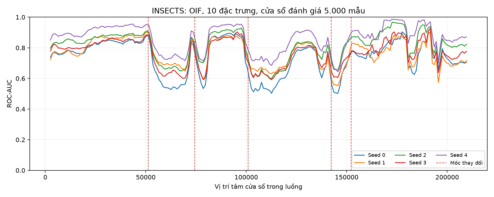

# INSECTS — 10 đặc trưng, năm seed sau sửa warm-up

212.514 dòng theo thứ tự gốc; 100 dòng đầu khởi động, 212.414 dòng chấm trước học. 32 cây, cửa sổ học 2.048, η=32, lô 100; ROC-AUC trượt 5.000, bước 1.000. Hai phương pháp cùng dữ liệu, nhưng baseline là sklearn dựng lại theo cửa sổ, không phải PySAD của tác giả.

| Run | ROC-AUC | Average precision | W&B |
|---|---:|---:|---|
| oif_seed0 | 0.691433 | 0.109064 | [run](https://forge.coreweave.com/wandb/24122055-university-of-science-viet-nam-national-univer/intro-ml-oif/runs/lpprt64h) |
| oif_seed1 | 0.722393 | 0.111798 | [run](https://forge.coreweave.com/wandb/24122055-university-of-science-viet-nam-national-univer/intro-ml-oif/runs/5nsp99kc) |
| oif_seed2 | 0.788159 | 0.161854 | [run](https://forge.coreweave.com/wandb/24122055-university-of-science-viet-nam-national-univer/intro-ml-oif/runs/bkkazl0o) |
| oif_seed3 | 0.728223 | 0.119941 | [run](https://forge.coreweave.com/wandb/24122055-university-of-science-viet-nam-national-univer/intro-ml-oif/runs/zrvo8y72) |
| oif_seed4 | 0.829587 | 0.327122 | [run](https://forge.coreweave.com/wandb/24122055-university-of-science-viet-nam-national-univer/intro-ml-oif/runs/gq0qkj76) |
| asdifor_seed0 | 0.786211 | 0.163345 | [run](https://forge.coreweave.com/wandb/24122055-university-of-science-viet-nam-national-univer/intro-ml-oif/runs/pqz5mwjq) |
| asdifor_seed1 | 0.785379 | 0.161320 | [run](https://forge.coreweave.com/wandb/24122055-university-of-science-viet-nam-national-univer/intro-ml-oif/runs/8w9ds7kg) |
| asdifor_seed2 | 0.785836 | 0.165065 | [run](https://forge.coreweave.com/wandb/24122055-university-of-science-viet-nam-national-univer/intro-ml-oif/runs/nijtz9s7) |
| asdifor_seed3 | 0.785417 | 0.154672 | [run](https://forge.coreweave.com/wandb/24122055-university-of-science-viet-nam-national-univer/intro-ml-oif/runs/5b66rbfq) |
| asdifor_seed4 | 0.798136 | 0.174971 | [run](https://forge.coreweave.com/wandb/24122055-university-of-science-viet-nam-national-univer/intro-ml-oif/runs/zkiiyp3g) |

## Tổng hợp

- oif: ROC-AUC trung vị 0.728223, Q1–Q3 [0.722393; 0.788159]; AP trung vị 0.119941.
- asdifor: ROC-AUC trung vị 0.785836, Q1–Q3 [0.785417; 0.786211]; AP trung vị 0.163345.

## Phục hồi OIF

Ngưỡng là AUC cửa sổ hoàn chỉnh cuối trước mốc; phục hồi là cửa sổ hoàn chỉnh sau mốc đầu tiên đạt lại ngưỡng trước mốc tiếp theo. Độ trễ tính đến cuối cửa sổ, bao gồm tích lũy 5.000 mẫu; không phải độ trễ thích nghi tức thời.

| Mốc | AUC trước, trung vị | AUC cửa sổ đầu sau, trung vị | Số seed phục hồi | Độ trễ trung vị khi phục hồi |
|---:|---:|---:|---:|---:|
| 51,255 | 0.870 | 0.731 | 0/5 | chưa quan sát |
| 74,381 | 0.749 | 0.624 | 5/5 | 9,719 |
| 100,944 | 0.891 | 0.613 | 0/5 | chưa quan sát |
| 142,291 | 0.696 | 0.607 | 4/5 | 9,309 |
| 152,207 | 0.730 | 0.824 | 5/5 | 5,893 |

Phân bố điểm trước/sau mốc đầu theo từng nhãn: [hình seed 0](../figures/drift-score-distribution-fixed-10.png); mỗi lớp chuẩn hóa riêng, không thể hiện tỷ lệ lớp.

Không so thời gian giữa các phương pháp vì các run OIF được chạy đồng thời. Paper Hình 7 báo trung vị 30 lần và dùng cửa sổ 5.000 mẫu; script tác giả học trước khi chấm, còn nhóm chấm trước học. Mô tả paper ghi 33 đặc trưng nhưng script tác giả dùng 10 cột đầu. Không so trực tiếp chênh lệch phần trăm.

Giới hạn độ sâu: Table 3 paper ghi log₂(ω/η), code tác giả và code nhóm dùng log₄(ω/η) cho cây nhị phân. Xem [phân tích phương pháp](drift-analysis-10.md).
