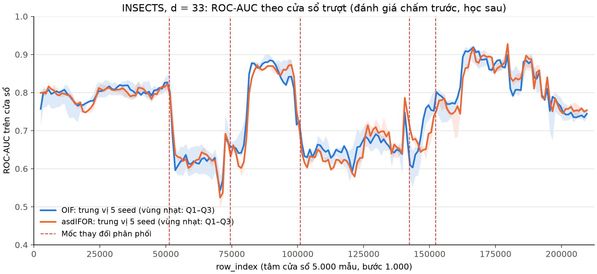

# Kết quả thí nghiệm concept drift trên INSECTS

**Trạng thái:** đã chạy 5 seed (0–4) với đủ 33 đặc trưng và 1 lượt đối chiếu 10 đặc trưng (seed 0), commit `b0a1790`. Kết quả thô nằm trong `results/raw/drift/` và `results/raw/drift_10features/` (Git bỏ qua), bảng đầy đủ ở [`drift-by-segment.csv`](drift-by-segment.csv). Chưa có đường dẫn W&B. Số liệu sinh bởi [`experiments/exp2_drift/plot_summary.py`](../experiments/exp2_drift/plot_summary.py).

Các lần chạy có `git_worktree_dirty = true` (d = 10: asdifor seed 0; d = 10: oif seed 0): lúc chạy, working tree có thay đổi chưa commit; cần đối chiếu `git_commit` trong `config.json`. Với lượt d = 10, thay đổi duy nhất là tệp `plot_summary.py` mới chưa được theo dõi, không được `run.py` dùng.

## Giao thức

- Dữ liệu `data/processed/insects.csv` (212.514 mẫu), giữ nguyên thứ tự dòng; không xáo trộn, không chia tập. Năm mốc thay đổi `51255, 74381, 100944, 142291, 152207` lấy từ script vẽ Hình 7 của tác giả (xem [`data/README.md`](../data/README.md)), chia luồng thành 6 đoạn.
- Đánh giá tuần tự **chấm điểm rồi mới học** (score-then-learn), theo lô 100. Lô đầu chỉ để khởi động; 212.414 mẫu còn lại được đánh giá. Nhãn chỉ dùng để tính chỉ số.
- OIF: 32 cây, `window_size = 2048`, `eta = 32`, seed rừng `seed * 32` để các seed không dùng chung cây (điểm F4 của `forest.py`).
- asdIFOR (nhóm tự dựng): `sklearn.ensemble.IsolationForest` 32 cây, `max_samples = 256`, huấn luyện lại trên 2048 mẫu gần nhất sau mỗi 2048 mẫu mới, giống ý tưởng cửa sổ rời của `pysad.IForestASD` mà tác giả dùng nhưng không phải cùng mã.
- Chỉ số: ROC-AUC, AP trên toàn luồng và từng đoạn; ROC-AUC trên cửa sổ trượt 5.000 mẫu, bước 1.000 (208 cửa sổ); thời gian học và chấm điểm (giây, CPU laptop, 1 luồng).

## Kết quả theo đoạn (d = 33, trung vị [Q1; Q3] qua 5 seed)

| Đoạn | `row_index` | Số mẫu | Bất thường | OIF ROC-AUC | asdIFOR ROC-AUC | OIF AP | asdIFOR AP | OIF giây | asdIFOR giây |
|---|---|---:|---:|---:|---:|---:|---:|---:|---:|
| Toàn luồng | 100–212513 | 212414 | 5,51% | 0,702 [0,698; 0,733] | 0,718 [0,711; 0,718] | 0,097 | 0,097 | 173,7 | 9,4 |
| 1 | 0–51254 | 51155 | 4,67% | 0,801 [0,793; 0,802] | 0,794 [0,794; 0,797] | 0,123 | 0,110 | 41,2 | 3,0 |
| 2 | 51255–74380 | 23126 | 3,71% | 0,593 [0,576; 0,633] | 0,600 [0,599; 0,604] | 0,044 | 0,045 | 18,4 | 0,9 |
| 3 | 74381–100943 | 26563 | 8,62% | 0,729 [0,725; 0,762] | 0,744 [0,720; 0,755] | 0,176 | 0,169 | 21,6 | 1,1 |
| 4 | 100944–142290 | 41347 | 2,19% | 0,654 [0,648; 0,681] | 0,658 [0,654; 0,659] | 0,031 | 0,032 | 33,1 | 1,6 |
| 5 | 142291–152206 | 9916 | 30,57% | 0,691 [0,652; 0,726] | 0,664 [0,660; 0,680] | 0,420 | 0,391 | 8,1 | 0,4 |
| 6 | 152207–212513 | 60307 | 3,69% | 0,762 [0,761; 0,776] | 0,754 [0,744; 0,756] | 0,079 | 0,076 | 48,8 | 2,4 |

Thời gian theo đoạn là tổng thời gian chấm điểm và học của các lô bắt đầu trong đoạn. Mỗi đoạn chỉ ghi tổng này; thời gian học và chấm điểm tách riêng chỉ có ở cấp toàn luồng (xem CSV).

## ROC-AUC theo cửa sổ trượt



Đường đậm là trung vị qua 5 seed, vùng nhạt là Q1–Q3; vạch đỏ đứt là 5 mốc thay đổi. Mỗi điểm đặt ở tâm cửa sổ (`row_start + 2500`), theo mô tả ở Mục 5.3 của bài báo. Đây là hình do nhóm tạo, không phải hình trích từ bài báo.

## Đối chiếu d = 33 và d = 10 (seed 0)

Script của tác giả chỉ dùng 10 đặc trưng đầu (`data[:, :10]`). Bảng so cùng seed 0 để tách ảnh hưởng của số đặc trưng khỏi phương sai theo seed.

| Đoạn | OIF d=33 | OIF d=10 | asdIFOR d=33 | asdIFOR d=10 | OIF AP d=33 | OIF AP d=10 |
|---|---:|---:|---:|---:|---:|---:|
| Toàn luồng | 0,733 | 0,735 | 0,711 | 0,786 | 0,097 | 0,123 |
| 1 | 0,793 | 0,841 | 0,793 | 0,871 | 0,101 | 0,194 |
| 2 | 0,576 | 0,688 | 0,604 | 0,714 | 0,041 | 0,065 |
| 3 | 0,762 | 0,746 | 0,755 | 0,807 | 0,166 | 0,209 |
| 4 | 0,654 | 0,731 | 0,658 | 0,769 | 0,031 | 0,047 |
| 5 | 0,726 | 0,647 | 0,680 | 0,753 | 0,439 | 0,374 |
| 6 | 0,776 | 0,773 | 0,722 | 0,801 | 0,078 | 0,085 |

Thời gian toàn luồng (seed 0): OIF 171,5 giây với d = 33 và 189,0 giây với d = 10; asdIFOR 9,4 và 10,0 giây.

ROC-AUC toàn luồng: OIF d = 10 đạt 0,735, nằm trong khoảng [0,688; 0,769] của 5 seed với d = 33; asdIFOR d = 10 đạt 0,786, nằm ngoài khoảng [0,706; 0,718] của 5 seed với d = 33. Chỉ có 1 seed cho d = 10, nên một giá trị nằm trong khoảng dao động theo seed chưa cho thấy khác biệt; giá trị nằm ngoài khoảng là dấu hiệu số đặc trưng có ảnh hưởng, cần thêm seed để khẳng định. Chênh lệch theo từng đoạn xem ở bảng trên; ở cấp đoạn chưa có khoảng dao động theo seed của d = 10 để so.

## Nhận xét

**Sụt giảm và phục hồi qua các mốc.** Thay đổi ROC-AUC trung vị từ đoạn trước sang đoạn sau mỗi mốc (d = 33):

| Mốc | Đoạn | OIF | asdIFOR |
|---|---|---:|---:|
| 51255 | 1 → 2 | -0,208 | -0,194 |
| 74381 | 2 → 3 |  0,136 | 0,143 |
| 100944 | 3 → 4 | -0,075 | -0,085 |
| 142291 | 4 → 5 |  0,037 | 0,005 |
| 152207 | 5 → 6 |  0,071 | 0,090 |

Hai mô hình thay đổi cùng chiều ở 5/5 mốc, phù hợp với nhận định ở Mục 5.3 rằng các thuật toán bị ảnh hưởng tương tự bởi thay đổi đột ngột. Trên đường cửa sổ trượt, điểm thấp nhất của OIF là 0,543 (tâm cửa sổ 70600) và của asdIFOR là 0,524 (tâm 70600). Cả hai đều chỉ nhớ 2048 mẫu gần nhất, nên sau mỗi mốc cần khoảng một cửa sổ học để thay toàn bộ mẫu cũ; cửa sổ đánh giá 5.000 mẫu làm mượt thêm nên đường cong không đổi tức thời tại vạch đỏ.

**Phương sai theo seed.** ROC-AUC toàn luồng của OIF nằm trong [0,688; 0,769] (IQR 0,035), của asdIFOR trong [0,706; 0,718] (IQR 0,007). Đoạn dao động mạnh nhất của OIF là đoạn 2 (0,481–0,678), của asdIFOR là đoạn 6 (0,722–0,763). Giả thuyết (chưa kiểm chứng): OIF dao động lớn hơn vì cấu trúc cây phụ thuộc chuỗi phép tách ngẫu nhiên tích lũy suốt luồng (mỗi lần tách còn sinh mẫu ảo), trong khi asdIFOR dựng lại toàn bộ rừng sau mỗi 2048 mẫu. Với 5 seed, chênh lệch trung vị toàn luồng giữa hai mô hình (0,015) nhỏ hơn khoảng dao động của OIF (0,081), nên chưa đủ cơ sở để nói mô hình nào tốt hơn trên INSECTS.

**Thời gian: Python thuần so với Cython.** Trung vị tổng thời gian là 173,7 giây với OIF (~818 µs/mẫu; học 126,9 giây, chấm điểm 46,9 giây) và 9,4 giây với asdIFOR, tức OIF chậm hơn khoảng 18 lần. Kết quả này ngược với Mục 5.3 (oIFOR nhanh nhất) và chủ yếu do cách cài đặt, không phải do độ phức tạp thuật toán:
- OIF của nhóm viết bằng Python thuần: mỗi mẫu đi qua vòng lặp Python trên 32 cây để học, và thêm một lần quên khi cửa sổ đầy. Mã của tác giả cũng là Python thuần.
- asdIFOR của nhóm gọi scikit-learn, nơi phần dựng và duyệt cây viết bằng Cython, và chỉ huấn luyện lại 120 lần trên toàn luồng; chấm điểm được vector hóa theo lô 100.
- Tác giả chạy asdIFOR qua `pysad`, với giao diện xử lý từng mẫu, nên số thời gian trong bài báo không so trực tiếp được với baseline của nhóm.

## Khác biệt so với bài báo và mã tác giả

- Bài báo chạy 30 lần; nhóm chạy 5 seed (d = 33) và 1 seed (d = 10).
- Mã tác giả học mỗi lô trước khi chấm điểm lô đó, nên điểm của một mẫu đã dùng chính mẫu đó; nhóm chấm điểm trước khi học. Mã tác giả cũng có thêm holdout ngẫu nhiên 10%, nhóm không dùng.
- Mã tác giả chỉ dùng 10 đặc trưng; bài báo ghi d = 33. Nhóm báo cáo chính với d = 33.
- Hình của nhóm dùng bước cửa sổ 1.000 và đặt điểm ở tâm cửa sổ; script vẽ của tác giả dùng bước 10 và co giãn chỉ số đầu cửa sổ theo độ dài luồng.
- Không chép số liệu bài báo; Hình 7 không có bảng số nên chỉ so được về hình dạng.

## Tệp kết quả

- `results/raw/drift/<model>_seed<s>/` và `results/raw/drift_10features/<model>_seed0/`: `config.json`, `metrics.json`, `predictions.csv` (cột `row_index, segment, label, anomaly_score`).
- [`drift-by-segment.csv`](drift-by-segment.csv): trung vị, Q1, Q3, min, max của ROC-AUC, AP, `learn_seconds`, `score_seconds`, `total_seconds` theo `n_features`, mô hình và phạm vi (`all`, `segment_1`…`segment_6`). Ô trống là chỉ số không được ghi cho phạm vi đó.
- [`../figures/drift-quality.png`](../figures/drift-quality.png).

## Tải kết quả lên W&B

Cần cài phần phụ thuộc W&B (`python -m pip install -e .[wandb]`), đăng nhập (`wandb login`) và đặt `WANDB_PROJECT`/`WANDB_ENTITY` trong `.env`; không đưa khóa API vào Git. Hai cách:

1. Chạy lại thí nghiệm với `WANDB_MODE=online`; `run.py` tự gọi `oif.tracking.log_run` sau khi ghi 3 tệp (khoảng 15 phút cho 5 seed).
2. Tải các lần chạy đã có mà không chạy lại mô hình:

```powershell
$env:WANDB_MODE = 'online'; $env:PYTHONPATH = 'src'
python -c "import json; from pathlib import Path; from oif.tracking import log_run; [print(d.name, log_run(json.loads((d/'config.json').read_text(encoding='utf-8')), json.loads((d/'metrics.json').read_text(encoding='utf-8')), d)) for p in ('results/raw/drift', 'results/raw/drift_10features') for d in sorted(Path(p).glob('*_seed*'))]"
```

Mỗi lần chạy thành một W&B run có tag `reproduction`, `drift` và tên mô hình, kèm 3 tệp kết quả dưới dạng artifact. Sau khi tải lên, bổ sung đường dẫn vào mục Trạng thái.
