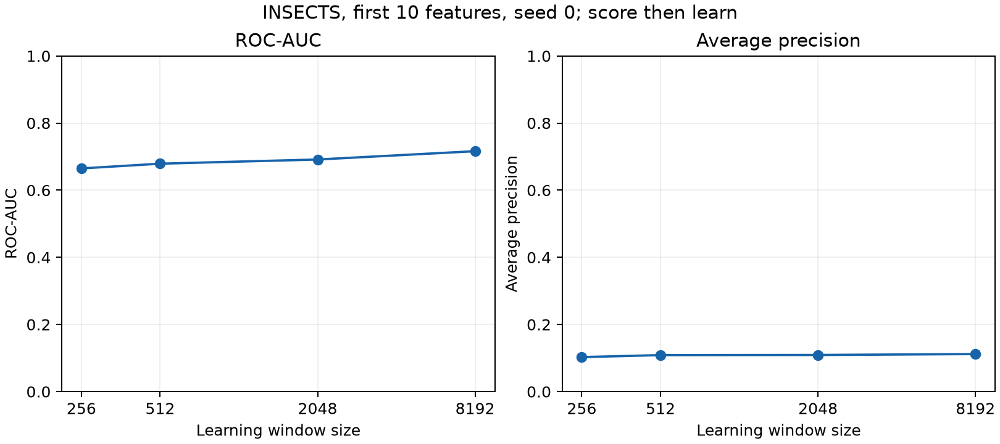

# Thí nghiệm 3 — độ nhạy theo kích thước cửa sổ trên INSECTS

Đã chạy lại ngày21/11/2026 bằng code nhóm sau sửa sinh mẫu node con/F4. Cả bốn ROC-AUC và AP khớp bảng window-sweep-10.csv lịch sử ở độ chính xác1e-12. Bộ kết quả mới có đủ config/metrics/predictions và W&B, không dùng các thí nghiệm protocol riêng ngoài bộ số liệu chốt.

## Thiết lập

- INSECTS212.514dòng,10đặc trưng đầu, giữ thứ tự gốc; không scaling/xáo trộn.
- OIF32cây, eta32, seed0; chỉ đổi omega=256,512,2048,8192.
- Chấm-trước-học theo lô100; bỏ lô đầu;212.414dòng được đánh giá.
- AUC/AP toàn luồng; cửa sổ đánh giá5.000,bước1.000, khác cửa sổ học omega.
- Bốn job chạy lại theo hai tiến trình đồng thời nên không dùng thời gian mới để kết luận tốc độ.
- Đây là phân tích bổ sung một seed, không phải thí nghiệm paper đã công bố.

## Kết quả

| omega | ROC-AUC | AP | W&B |
|---:|---:|---:|---|
| 256 | 0.664851 | 0.102712 | [run](https://forge.coreweave.com/wandb/24122055-university-of-science-viet-nam-national-univer/intro-ml-oif/runs/4bb812c60af8e0af) |
| 512 | 0.678980 | 0.108681 | [run](https://forge.coreweave.com/wandb/24122055-university-of-science-viet-nam-national-univer/intro-ml-oif/runs/a70738361a0eeede) |
| 2048 | 0.691433 | 0.109064 | [run](https://forge.coreweave.com/wandb/24122055-university-of-science-viet-nam-national-univer/intro-ml-oif/runs/eec19233b63f00f6) |
| 8192 | 0.716189 | 0.111853 | [run](https://forge.coreweave.com/wandb/24122055-university-of-science-viet-nam-national-univer/intro-ml-oif/runs/2d95959b828e3aae) |

AUC tăng0,051339 từ omega256đến8192 trong seed này; AP tăng0,009141. Không đủ để kết luận omega8192tối ưu hoặc cửa sổ lớn luôn thích nghi nhanh hơn. AUC toàn luồng chưa đo trực tiếp độ trễ phục hồi.

## Tái lập

Dùng experiments/exp3_window/run.py từ gốc repo với PYTHONPATH=src và WANDB_MODE=disabled; output mặc định results/raw/window-sweep-f4-10. Manifest URL ở window-wandb-links.json. Mỗi artifact chứa config.json,metrics.json,predictions.csv và biểu đồ AUC trượt trên run.

Code nguồn f780d865 (commit này chỉ thêm ZIP, thuật toán ở0ea32145). Worktree khi chạy còn runner exp3 chưa commit; config ghi git_worktree_dirty=true. File src/oif không đổi. SHA dataset nằm trong config.
