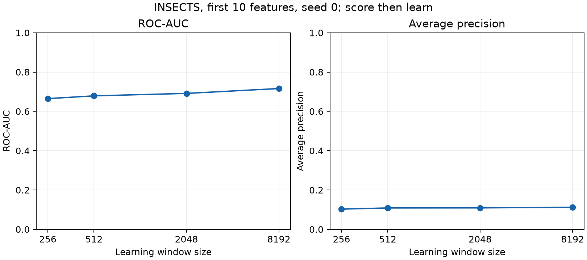

# Nháp slide thí nghiệm 3 — Độ nhạy theo kích thước cửa sổ

Hai slide mở rộng để ghép sau kết quả drift, trước tổng kết 8.2. Giữ format
nội dung → hình/bảng → speaker notes → nguồn IEEE như các nháp của nhóm.

## Slide TN3.1 — Cửa sổ học ảnh hưởng chất lượng như thế nào?

**Nội dung trên slide**

- Câu hỏi: lượng dữ liệu ghi nhớ ảnh hưởng thế nào đến chất lượng phát hiện?
- INSECTS: 212.514 mẫu, 10 đặc trưng đầu; giữ nguyên thứ tự thời gian.
- OIF: 32 cây, η = 32, seed 0; chỉ đổi ω ∈ {256, 512, 2048, 8192}.
- Chấm trước học, lô 100; đánh giá 212.414 mẫu sau lô khởi động.
- Đo ROC-AUC và AP toàn luồng. Cửa sổ học ω khác cửa sổ đánh giá 5.000 mẫu.

**Hình minh họa / Biểu đồ**

Sơ đồ bốn hàng FIFO, cùng mẫu mới đi vào và mẫu cũ đi ra; ghi rõ ω ở từng hàng.
Nhãn chỉ nối tới khối tính ROC-AUC/AP. Hình giải thích thiết lập, không khẳng định
tốc độ thích nghi đã được đo.

**Speaker notes**

Mục 4.3 của paper thảo luận đánh đổi giữa tốc độ thích nghi và độ chính xác mô
hình hóa khi chọn cửa sổ nhớ. Nhóm thiết kế sweep này làm phân tích bổ sung,
không tái tạo một bảng kết quả có sẵn trong bài báo.

Cả bốn cấu hình dùng cùng dữ liệu, thứ tự và seed; chỉ đổi dung lượng cửa sổ
học. Trong code nhóm, giới hạn độ sâu còn phụ thuộc số mẫu hiệu dụng trong
cửa sổ. Vì vậy đổi ω đồng thời ảnh hưởng mức phân giải cây; phép thử đo tổng
tác động cấu hình, chưa cô lập riêng cơ chế quên.

Mô hình chấm cả lô trước khi học; 100 mẫu đầu chỉ dùng khởi động. Nhãn không
được đưa vào cập nhật cây. Cửa sổ đánh giá AUC 5.000, bước 1.000 dùng chung
cho các cấu hình, không phải dung lượng ghi nhớ của mô hình. Chỉ có một seed,
nên đây là khảo sát ban đầu và chưa xác định được độ ổn định của kết quả.

**Nguồn IEEE**

[1] F. Leveni, G. Weigert Cassales, B. Pfahringer, A. Bifet, and G. Boracchi,
“Online Isolation Forest,” in Proc. 41st Int. Conf. Machine Learning,
PMLR, vol. 235, pp. 27288–27298, 2024, sec. 4.3.
[2] Nhóm, experiments/exp3_window/run.py và results/window-sweep-f4-10.md;
config, metrics, predictions trong các run W&B của thí nghiệm 3.

## Slide TN3.2 — Cửa sổ lớn hơn cho AUC cao hơn trong seed khảo sát

**Nội dung trên slide**

| Cửa sổ học ω | ROC-AUC | AP | W&B |
|---:|---:|---:|---|
| 256 | 0.665 | 0.103 | [run](https://forge.coreweave.com/wandb/24122055-university-of-science-viet-nam-national-univer/intro-ml-oif/runs/4bb812c60af8e0af) |
| 512 | 0.679 | 0.109 | [run](https://forge.coreweave.com/wandb/24122055-university-of-science-viet-nam-national-univer/intro-ml-oif/runs/a70738361a0eeede) |
| 2048 | 0.691 | 0.109 | [run](https://forge.coreweave.com/wandb/24122055-university-of-science-viet-nam-national-univer/intro-ml-oif/runs/eec19233b63f00f6) |
| 8192 | 0.716 | 0.112 | [run](https://forge.coreweave.com/wandb/24122055-university-of-science-viet-nam-national-univer/intro-ml-oif/runs/2d95959b828e3aae) |

- Từ ω = 256 đến 8192: ROC-AUC tăng 0,0513; AP tăng 0,0091 trong seed 0.
- Chưa kết luận cửa sổ lớn luôn tốt hơn hoặc phục hồi nhanh hơn: chỉ một seed,
  chưa so độ trễ phục hồi giữa các cấu hình.

**Hình minh họa / Biểu đồ**

**Speaker notes**

Đây là kết quả OIF nhóm sau sửa sinh mẫu thống kê hai node con và cấp seed F4.
Bốn cấu hình đã được chạy lại và kiểm chỉ số từ predictions.csv; ROC-AUC/AP
khớp bảng sweep lịch sử. Các link trong bảng trỏ tới đúng từng cấu hình, có đủ
config.json, metrics.json, predictions.csv và đường AUC trượt.

Trong seed 0, AUC tăng theo bốn mức cửa sổ; AP cũng tăng nhưng mức tăng nhỏ hơn.
ω = 8192 đạt AUC cao nhất trong bốn mức đã thử, không có nghĩa là cấu hình
tối ưu tổng quát. Chất lượng toàn luồng có thể che những giai đoạn giảm sau
drift. Cần nhiều seed và so đường AUC hoặc độ trễ phục hồi theo mốc để kết luận
về độ ổn định và tốc độ thích nghi.

Các lượt chạy lại được thực hiện đồng thời, nên không dùng thời gian để so
tốc độ giữa các cấu hình. Không trộn sweep 10 đặc trưng này với kết quả drift
33 đặc trưng. Độ lệch so với số paper cho sweep không áp dụng: paper không có
bảng cùng bốn mức này; đây là phân tích bổ sung do nhóm thiết kế.

**Nguồn IEEE**

[1] F. Leveni et al., “Online Isolation Forest,” ICML, PMLR vol. 235, 2024,
sec. 4.3.
[2] Nhóm, results/window-sweep-f4-10.md và W&B run theo từng hàng trong bảng.
