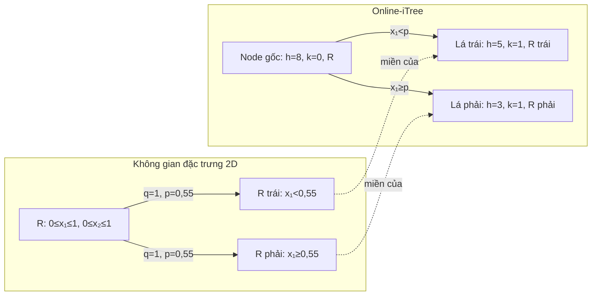
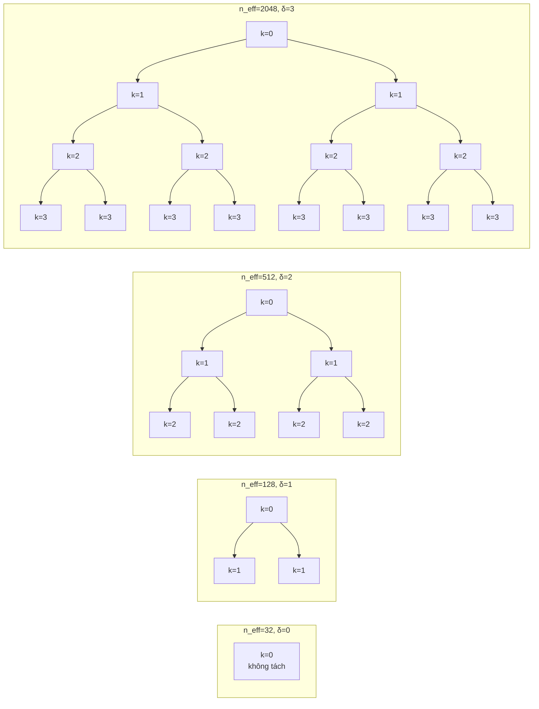
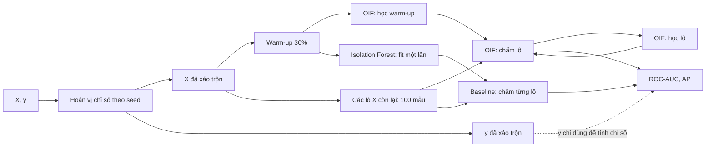
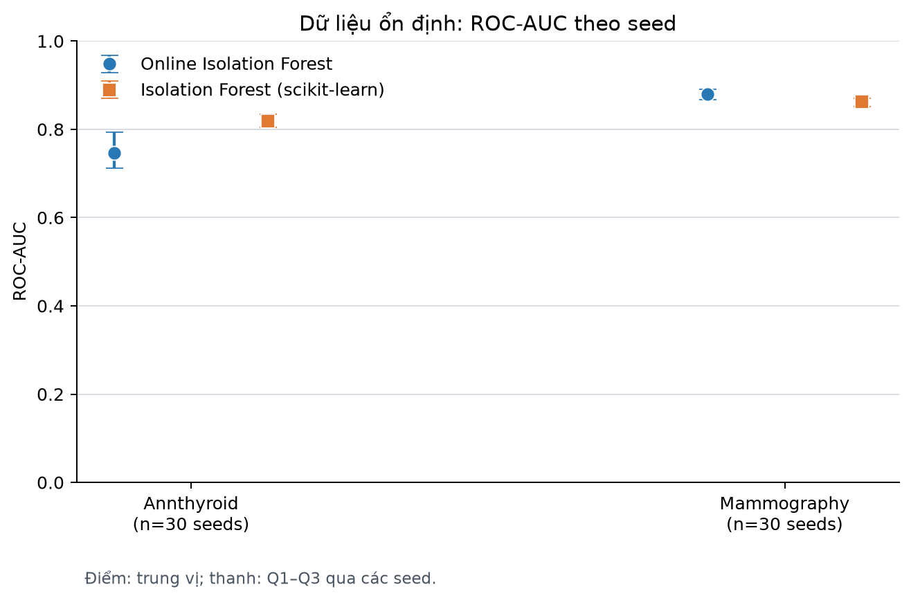
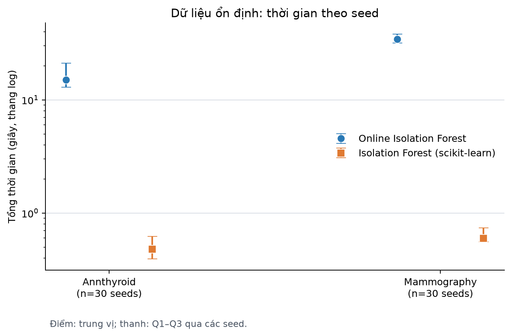

# Slide của Phúc — phương pháp và dữ liệu ổn định (3.2, 3.3, 5.1, 6.1, 7.1)

Mỗi slide có nội dung, hình/bảng, speaker notes và nguồn IEEE. Ký hiệu: `h` là khối lượng (`mass` trong
code), `k` là độ sâu, `R` là miền bao, `τ` là số cây, `ω` là cỡ cửa sổ. Thí nghiệm gồm 120 run
(2 bộ dữ liệu × 2 phương pháp ×
30 seed); 120 `config.json`, 120 `metrics.json` và 120 `predictions.csv` được lưu tại
[`results/raw/stationary-seedblock/`](../results/raw/stationary-seedblock/).
Kết quả tổng hợp nằm ở [`results/stationary.md`](../results/stationary.md) và
[`results/stationary-summary.csv`](../results/stationary-summary.csv).

---

## Slide 3.2 — Online-iTree: histogram phân cấp thích nghi

**Nội dung trên slide**

- Một Online-iTree là histogram đa chiều, được biểu diễn bằng cây nhị phân; mỗi node ứng với một ô không gian.
- Node lưu `h` (số mẫu đi qua) và miền bao `R = [lower, upper]`; node trong lưu thêm chiều chia `q`, ngưỡng `p` và hai node con.
- Rừng Online-iForest gồm `τ` cây; cửa sổ trượt giữ tối đa `ω` mẫu mới nhất.
- Các ô có thể tách khi học thêm dữ liệu và gộp khi quên dữ liệu cũ.

**Hình minh họa / Biểu đồ**

Minh họa: node gốc khối lượng 8 chia tại `x₁=0,55`, tạo hai lá khối lượng 5 và 3.

**Speaker notes**

Online-iTree mô hình hóa không gian đặc trưng bằng cách chia đệ quy thành các ô. Node `N = (h, R)` trong bài báo lưu chiều cao ô `h`, tức số điểm đi qua node, và miền bao `R`; trong code nhóm, đại lượng này có tên `mass`, còn miền bao được lưu bằng `lower` và `upper` (`src/oif/tree.py`). `k` là độ sâu của node, khác với `h`. Node trong còn giữ chiều chia và ngưỡng để định tuyến điểm xuống một trong hai con: nếu `x_q < p` thì sang trái, ngược lại sang phải. Node lưu khối lượng, miền bao, thông tin phép chia và hai liên kết con; không lưu danh sách mẫu thật.

Tập hợp `τ` Online-iTree tạo thành Online-iForest. Cửa sổ FIFO thuộc bộ quản lý rừng: khi cửa sổ đầy,
mẫu cũ nhất được đưa vào thủ tục quên của mọi cây. Hai thủ tục học và quên được trình bày ở các slide tiếp theo; slide này chỉ mô tả trạng thái mà hai thủ tục đó thay đổi [1].

[1] F. Leveni, G. Weigert Cassales, B. Pfahringer, A. Bifet, and G. Boracchi, "Online Isolation
Forest," in *Proc. 41st Int. Conf. Machine Learning*, PMLR, vol. 235, pp. 27288–27298, 2024.

---

## Slide 3.3 — Khởi tạo cây và điều kiện dừng

**Nội dung trên slide**

- Cây bắt đầu là một lá gốc rỗng: `h = 0`, `k = 0`, `R` rỗng; mẫu đầu tiên đặt `R` bằng chính điểm đó
- Cấu hình: `τ = 32` cây, `ω = 2048`, `η = 32`; cây nhị phân, chia song song trục
- Tách lá khi đồng thời `h ≥ ĥ(k) = η·2^k` và `k < δ`
- `δ` phụ thuộc số mẫu hiện có `n_eff`, không làm tròn:

$$
\delta(n_{eff}) = \begin{cases}
0, & n_{eff} \leq \eta \\
\frac{\ln(n_{eff}/\eta)}{\ln 4}, & n_{eff} > \eta
\end{cases}
$$

| `n_eff` | 32 | 128 | 512 | 2048 |
|---|---:|---:|---:|---:|
| `δ` | 0 | 1 | 2 | 3 |
| Độ sâu `k` được phép tách | không có | 0 | 0–1 | 0–2 |

*`h`: khối lượng ô; `k`: độ sâu; `R`: miền bao; `η`: số mẫu cơ sở; `ĥ(k)`: ngưỡng khối lượng tại độ sâu `k`;
`δ`: giới hạn độ sâu dạng số thực; `n_eff`: số mẫu hiện có trong cửa sổ.*

**Hình minh họa / Biểu đồ**

Sơ đồ thể hiện giới hạn độ sâu theo `δ`. Node được tách khi đồng thời `h ≥ ĥ(k)` và `k < δ`.

**Speaker notes**

Online-iTree không được dựng sẵn từ một tập dữ liệu như Isolation Forest truyền thống. Cây bắt đầu từ một lá gốc rỗng, khối lượng bằng 0 và chưa có miền bao. Mẫu đầu tiên đặt miền bao bằng chính điểm đó; các mẫu sau nới dần miền bao. Cấu trúc cây hình thành qua thủ tục học; trạng thái khởi tạo gồm lá gốc, các tham số và điều kiện tách [1].

`τ` là số cây trong rừng; `ω` là số mẫu tối đa trong cửa sổ. `η` là ngưỡng khối lượng cơ sở:
một lá ở độ sâu `k` được tách khi có ít nhất `η·2^k` mẫu. Ngưỡng này tăng gấp đôi sau mỗi tầng;
với phép chia cân bằng, mỗi con nhận khoảng một nửa khối lượng của cha.

Điều kiện thứ hai là giới hạn độ sâu `δ`. Bài báo ghi `δ = log₂(ω/η)`, bằng 6 với cấu hình trên; code
tác giả dùng `log₄(ω/η)` cho cây nhị phân, bằng 3 [2]. Nhóm theo code tác giả, và tính `δ` từ số mẫu
đang giữ `n_eff` thay vì từ `ω`. Trong giai đoạn khởi động, `δ` tăng dần: với 32 mẫu chưa lá nào
được tách, với 128 mẫu chỉ gốc được tách, khi cửa sổ đầy cây có tối đa ba tầng chia. `δ` giữ kiểu số
thực, không làm tròn, và điều kiện tách là `k < δ`.

Bảng trên slide thể hiện hai điều kiện tách: lá phải đạt ngưỡng khối lượng và độ sâu phải nhỏ hơn `δ`.
Khi đủ điều kiện, code sinh mẫu ảo đều trong miền bao như slide 3.4 mô tả. Chú thích Hình 2 của paper
ghi số mẫu ảo là `ĥ(k)`, còn mục 4.1 ghi `h`. Code nhóm lấy `node.mass` mẫu ảo (`src/oif/learning.py`)
rồi chia chúng theo ngưỡng. Tổng mass của hai node con bằng mass của node cha.

[1] F. Leveni, G. Weigert Cassales, B. Pfahringer, A. Bifet, and G. Boracchi, "Online Isolation
Forest," in *Proc. 41st Int. Conf. Machine Learning*, PMLR, vol. 235, pp. 27288–27298, 2024.
[2] F. Leveni, "Online-Isolation-Forest," GitHub repository, commit e528c86, 2024. [Online].
Available: https://github.com/ineveLoppiliF/Online-Isolation-Forest

---

## Slide 5.1 — Dữ liệu ổn định: Annthyroid và Mammography

**Nội dung trên slide**

| Bộ dữ liệu | Số dòng (nhóm) | Số dòng (bài báo) | Đặc trưng | Bất thường (nhóm) | Bất thường (bài báo) |
|---|---:|---:|---:|---:|---:|
| Annthyroid | 7.200 | 6.832 | 6 | 534 (7,42%) | 7,00% |
| Mammography | 11.183 | 11.183 | 6 | 260 (2,32%) | 2,00% |

- Tệp lấy từ thư mục `datasets/stationary/ifor` trong repo tác giả [1]; chỉ bỏ cột ID, giữ mọi dòng
- Tệp Annthyroid của nhóm có nhiều hơn 368 dòng so với số liệu trong bài báo [2], [3]
- Phạm vi: 2 bộ dữ liệu ổn định; 30 seed (0–29); ROC-AUC, AP và thời gian

**Hình minh họa / Biểu đồ**

Bảng ghi số dòng, số đặc trưng và tỷ lệ nhãn bất thường của từng bộ dữ liệu.

**Speaker notes**

Tệp Annthyroid nhóm dùng có 7.200 dòng, gồm 6.666 bình thường và 534 bất thường (7,42%). UCI ghi bộ ANN có 3.772 dòng train và 3.428 dòng test [4]; OpenML cũng ghi tổng 7.200 dòng [5]. Bảng Isolation Forest 2008 ghi 6.832 dòng và 7%; bài báo Online Isolation Forest lặp lại cặp số đó [2], [3]. Azzari và Bicego ghi họ không khôi phục được bản 6.832 dòng; bản trên web có 7.200 dòng, còn nghiên cứu đó báo tỷ lệ outlier 2% khi dùng bản 7.200 [6]. Script nhóm xác minh SHA-256, bỏ cột ID và giữ toàn bộ 7.200 dòng; trong tệp có 138 dòng trùng theo đặc trưng và nhãn. Mammography có 11.183 dòng, 260 bất thường (2,32%) và 6 đặc trưng. Hai bộ dữ liệu được xử lý như luồng ổn định, không gắn mốc drift.

[1] F. Leveni, "Online-Isolation-Forest," GitHub repository, commit e528c86, 2024. [Online].
Available: https://github.com/ineveLoppiliF/Online-Isolation-Forest
[2] F. T. Liu, K. M. Ting, and Z.-H. Zhou, "Isolation Forest," in *Proc. 8th IEEE Int. Conf. Data
Mining (ICDM)*, 2008, pp. 413–422, doi: 10.1109/ICDM.2008.17.
[3] F. Leveni, G. Weigert Cassales, B. Pfahringer, A. Bifet, and G. Boracchi, "Online Isolation
Forest," in *Proc. 41st Int. Conf. Machine Learning*, PMLR, vol. 235, pp. 27288–27298, 2024.
[4] UCI Machine Learning Repository, "Thyroid Disease," dataset 102. [Online]. Available:
https://archive.ics.uci.edu/dataset/102/thyroid%2Bdisease
[5] OpenML, "Annthyroid," dataset 40886. [Online]. Available:
https://www.openml.org/search?id=40886&sort=runs&type=data
[6] A. Azzari and M. Bicego, "An empirical characterization of the stability of Isolation Forest
results," in *Proc. Joint IAPR Int. Workshops S+SSPR*, 2024, pp. 166–176,
doi: 10.1007/978-3-031-80507-3_17.

---

## Slide 6.1 — Giao thức đánh giá dữ liệu ổn định

**Nội dung trên slide**

- Mỗi seed xáo trộn dữ liệu một lần; OIF và baseline dùng cùng thứ tự
- 30% đầu làm warm-up; phần còn lại đánh giá theo lô 100
- OIF chấm điểm mỗi lô rồi mới học lô đó; baseline Isolation Forest (scikit-learn) học trên warm-up rồi giữ cố định
- Cấu hình OIF: 32 cây, `ω = 2048`, `η = 32`; 30 seed (0–29); nhãn chỉ dùng để tính chỉ số

**Hình minh họa / Biểu đồ**

Sơ đồ: mỗi seed dùng chung hoán vị cho hai phương pháp; nhãn chỉ đi vào bước tính chỉ số.

**Speaker notes**

Nhãn chỉ dùng để tính chỉ số, không được đưa vào cập nhật mô hình. Baseline là `IsolationForest` của scikit-learn [2], học một lần trên phần warm-up rồi giữ cố định. Với dữ liệu ổn định, thứ tự mẫu
không mang thông tin thời gian; protocol xáo trộn theo seed để mỗi lần chạy có một thứ tự mẫu khác nhau. OIF và baseline trong cùng seed dùng chung thứ tự mẫu; INSECTS giữ thứ tự gốc.

Với mỗi dataset và seed, hai phương pháp dùng cùng thứ tự mẫu. 30% đầu là warm-up; các mẫu còn lại được đánh giá theo lô 100. OIF chấm điểm rồi cập nhật từng lô; Isolation Forest fit một lần trên warm-up và giữ cố định. Nhãn chỉ dùng để tính chỉ số. Bài báo chạy oIFOR trên toàn luồng và so sánh với năm phương pháp trực tuyến qua PySAD [1]; protocol nhóm dùng warm-up 30% và baseline ngoại tuyến cố định.

[1] F. Leveni, G. Weigert Cassales, B. Pfahringer, A. Bifet, and G. Boracchi, "Online Isolation
Forest," in *Proc. 41st Int. Conf. Machine Learning*, PMLR, vol. 235, pp. 27288–27298, 2024.
[2] F. Pedregosa *et al.*, "Scikit-learn: Machine learning in Python," *J. Machine Learning
Research*, vol. 12, pp. 2825–2830, 2011.

---

## Slide 7.1 — Kết quả dữ liệu ổn định

**Nội dung trên slide**

| Bộ dữ liệu | Phương pháp | ROC-AUC nhóm, median [Q1; Q3] | AP median | Tổng thời gian median (s) |
|---|---|---:|---:|---:|
| Annthyroid | OIF | 0,747 [0,712; 0,793] | 0,276 | 15,03 |
| Annthyroid | Isolation Forest (scikit-learn) | 0,819 [0,804; 0,834] | 0,308 | 0,48 |
| Mammography | OIF | 0,881 [0,867; 0,891] | 0,234 | 34,41 |
| Mammography | Isolation Forest (scikit-learn) | 0,863 [0,852; 0,870] | 0,192 | 0,60 |

*Bảng 4 oIFOR: Annthyroid 0,685; Mammography 0,854 [1]. Run cục bộ: [`stationary-seedblock`](../results/raw/stationary-seedblock/).*

<!-- W&B status begin -->
**W&B:** 0/120 run được tải lên; hiện chưa có tài khoản/API key để xác thực.
<!-- W&B status end -->

- Protocol nhóm: warm-up 30%, OIF cập nhật theo lô; baseline fit một lần trên warm-up
- Annthyroid trong tệp nhóm có 7.200 dòng; Bảng 4 báo 6.832 dòng

**Hình minh họa / Biểu đồ**

Biểu đồ ROC-AUC thể hiện trung vị và Q1–Q3 của 30 seed.

**Speaker notes**

Trong 30 seed, ROC-AUC trung vị của OIF và Isolation Forest lần lượt là 0,7468 và 0,8187 trên Annthyroid; 0,8805 và 0,8633 trên Mammography. Chênh lệch OIF trừ baseline là −0,0719 và +0,0173. AP trung vị lần lượt là 0,2757 so với 0,3077 và 0,2344 so với 0,1920.

So với ROC-AUC oIFOR trong Bảng 4 (0,685 Annthyroid; 0,854 Mammography), kết quả OIF nhóm chênh +0,0618 (+9,02%) và +0,0265 (+3,10%). Thí nghiệm nhóm dùng warm-up 30%, baseline cố định và 7.200 dòng Annthyroid; bài báo dùng toàn luồng, năm phương pháp trực tuyến và báo 6.832 dòng Annthyroid.

Thời gian tổng trung vị là 15,0283 giây (OIF) và 0,4776 giây (baseline) trên Annthyroid; 34,4144 giây và 0,5987 giây trên Mammography. Baseline fit một lần trên warm-up; OIF cập nhật 32 cây trong quá trình đánh giá. Thời gian được tính bằng giây và gồm fit/cập nhật cùng chấm điểm.

Runner dùng 30 seed (0–29); seed rừng là `32 × seed` và cây thứ `i` dùng `32 × seed + i`. Các tệp `config.json` ghi commit `32d594f` (có L1 `ceeaed8` và F1 `6ac25e3`) cùng `git_worktree_dirty=true`. Mỗi run có `config.json`, `metrics.json`, `predictions.csv`; tổng cộng 120 tệp của mỗi loại được lưu ở `results/raw/stationary-seedblock/`.

[1] F. Leveni, G. Weigert Cassales, B. Pfahringer, A. Bifet, and G. Boracchi, "Online Isolation
Forest," in *Proc. 41st Int. Conf. Machine Learning*, PMLR, vol. 235, pp. 27288–27298, 2024.
[2] F. Pedregosa *et al.*, "Scikit-learn: Machine learning in Python," *J. Machine Learning
Research*, vol. 12, pp. 2825–2830, 2011.
